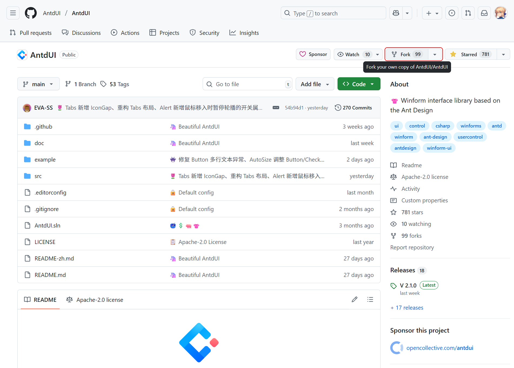
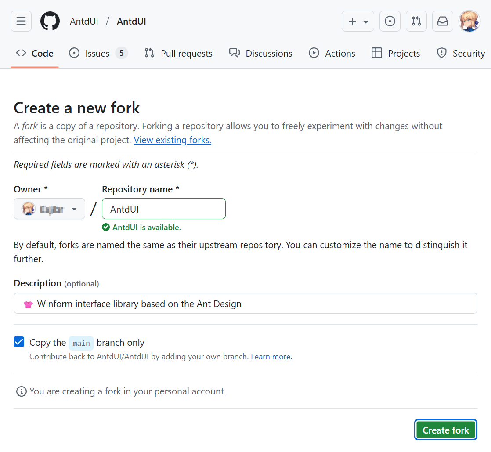
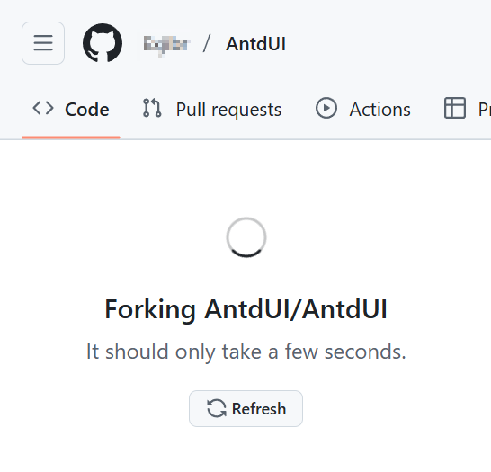
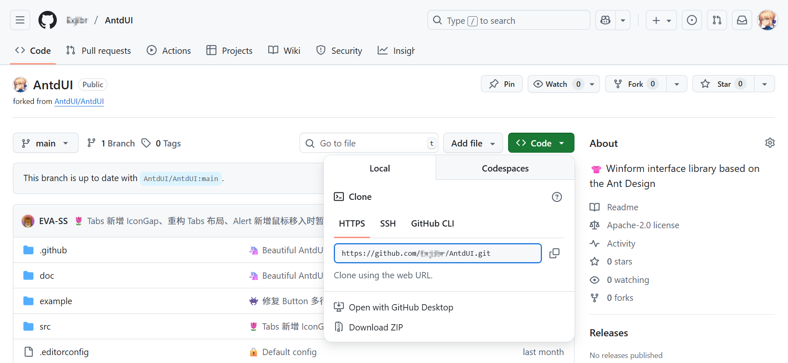
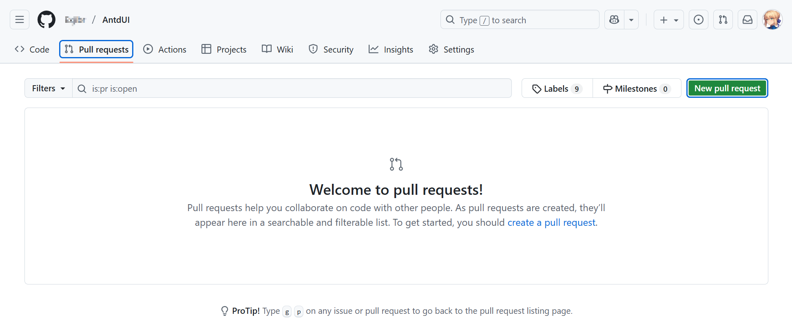
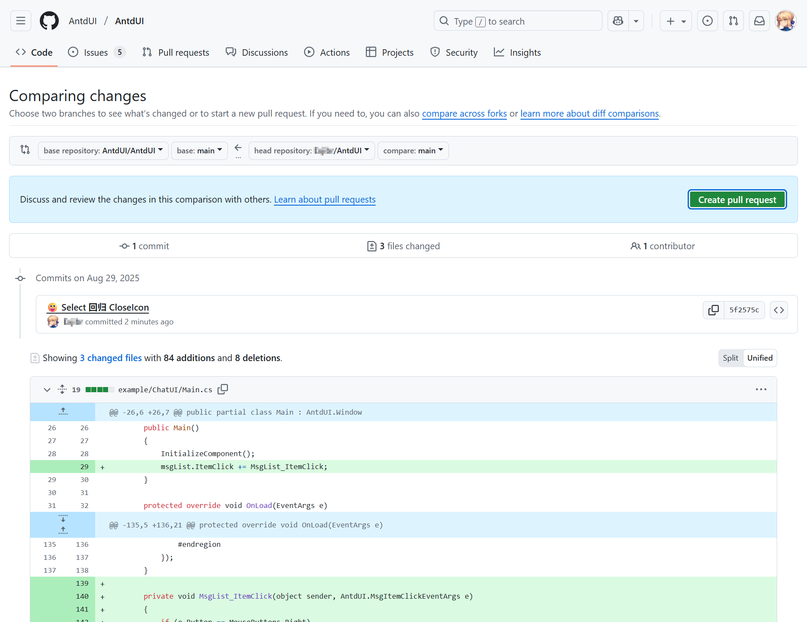
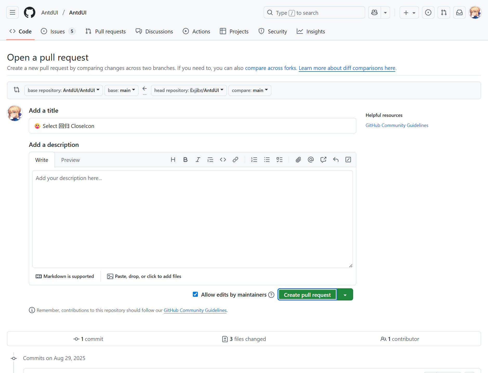
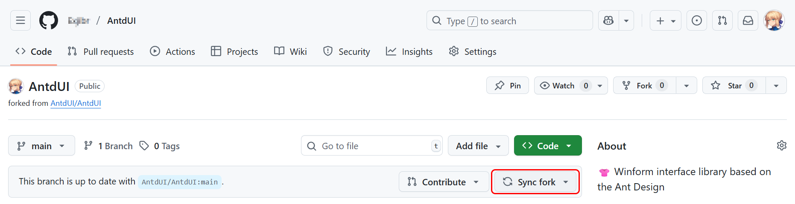

# 🦄 Contributing to AntdUI

This guide explains the standards and workflows to help you collaborate smoothly, maintain code consistency, and navigate the project effectively.

## Table of Contents

1. [Directory Structure](#1-directory-structure)
2. [Code Standards](#2-code-standards)
   - 2.1 [General rules](#21-general-rules)
   - 2.2 [Custom controls: IControl](#22-custom-controls-icontrol)
   - 2.3 [Windows: BaseForm / Window](#23-windows-baseform--window)
   - 2.4 [Layered windows: the ILayeredForm family](#24-layered-windows-the-ilayeredform-family)
   - 2.5 [Global events: IEventListener / EventHub](#25-global-events-ieventlistener--eventhub)
   - 2.6 [Animation: AnimationTask](#26-animation-animationtask)
   - 2.7 [Helpers](#27-helpers)
3. [Contribution Workflow](#3-contribution-workflow)
4. [Sync Your Fork After the PR Is Merged](#4-sync-your-fork-after-the-pr-is-merged)
5. [Troubleshooting](#5-troubleshooting)
   - 5.1 [Your fork is out of sync with the official repository](#51-your-fork-is-out-of-sync-with-the-official-repository)
   - 5.2 [Delete and re-fork when commits are messed up](#52-delete-and-re-fork-when-commits-are-messed-up)
   - 5.3 [You committed to the wrong branch](#53-you-committed-to-the-wrong-branch)
   - 5.4 [Your PR receives review feedback requiring changes](#54-your-pr-receives-review-feedback-requiring-changes)

---

## 1. Directory Structure
Familiarize yourself with the directory layout to ensure your contributions are placed in the correct location:

```
AntdUI/
├─ src/                      # All core library source code
│  ├─ AntdUI/                # Main UI library code
│  │  ├─ Controls/           # Custom UI controls
│  │  │  ├─ Chat/            # Chat-related controls (separated due to independent logic or large code volume)
│  │  │  └─ Core/            # Core drawing classes and implementation classes
│  │  ├─ Design/             # Designer support (e.g., Visual Studio designer integration)
│  │  ├─ Enum/               # Enumerations used across the library (e.g., theme types, control states)
│  │  ├─ Events/             # Event definitions
│  │  ├─ Forms/              # Custom windows/forms
│  │  │  └─ LayeredWindow/   # Popup/layered windows (e.g., dropdowns, date pickers, modals, drawers)
│  │  ├─ Lib/                # Utility files (Win32 API wrappers, SVG handlers, helper classes)
│  │  ├─ Localization/       # Multi-language support (resource files for different locales)
│  │  └─ Style/              # Theme definitions (e.g., light/dark themes, color palettes)
│  └─ AntdUI.EmojiFluentFlat/ # Emoji Fluent Flat resource library
├─ example/                  # Demo projects to showcase control usage
│  └─ Demo/                  # Main demo project (includes test forms for all controls)
└─ doc/                      # Documentation (contribution guides, API references, etc.)
```

- **New Controls**: Add custom controls to `src/AntdUI/Controls/` (use subfolders like `Chat/` for independent or large controls).
- **Utility Code**: Place helper functions, Win32 wrappers, or SVG tools in `src/AntdUI/Lib/`.
- **Demo Code**: Update `example/Demo/` to include test cases for new features (helps verify functionality and assist other contributors).

## 2. Code Standards

> This chapter gives APIs, call sites and return-value meanings you can copy directly. Wherever it says "must", it is the convention used by every built-in control; deviating makes your control behave differently from the rest of the library.

### 2.1 General rules

1. **UI only**: AntdUI is a pure UI library on WinForms. It owns appearance, layout, interaction and theme adaptation and nothing else. **Never** implement HTTP requests, file transfer, database access, business calculation or account systems inside the library. When such a capability is needed, only expose an API hook that the consumer implements.
2. **No heavy dependencies**: browser engines (CefSharp / WebView2), ORM, logging/serialization frameworks, audio/video codecs are not accepted. Where the .NET ecosystem already has a better solution, do not add a beautified wrapper here.
3. **Multi-target compatibility**: the library targets several .NET frameworks (see `TargetFrameworks` in [AntdUI.csproj](src/AntdUI/AntdUI.csproj)). Do not use APIs that only exist on some targets; branch with `#if` when necessary.
4. **No new dependencies**: adding a `PackageReference` requires maintainer approval first.
5. **Consistent style**: naming, comments, `[Description]`/`[Category]`/`[DefaultValue]` attributes, and `Invalidate()` + `OnPropertyChanged()` on property changes must match existing controls.


### 2.2 Custom controls: IControl

Source: [IControl.cs](src/AntdUI/Controls/IControl.cs)

**Inheritance and constructor**

```csharp
public class MyControl : IControl
{
    public MyControl() : base(ControlType.Select) { }
}
```

`ControlType` decides focus and click behavior:

| Value | Fits | Behavior |
| --- | --- | --- |
| `ControlType.Default` | Display-only controls (Label, Tag, image) | Not in the Tab order, never takes focus |
| `ControlType.Select` | Input / selection controls (Input, Select, Tree) | Can take focus and keyboard input |
| `ControlType.Button` | Click controls (Button, segmented item) | Adds to `Select` by disabling system double-click dispatch, so a double click does not raise `Click` twice |

**Drawing entry points**

```csharp
protected override void OnDraw(DrawEventArgs e)
{
    base.OnDraw(e);
    e.Canvas.DrawText("Hello 👍", Font, ForeColor, e.Rect, FormatFlags.Left | FormatFlags.VerticalCenter);
}
```

- Background goes in `OnDrawBg`, content in `OnDraw`; the base `OnPaint` calls them in that order.
- `e.Canvas` is the drawing surface, `e.Rect` is the available area.
- **Do not** draw content in `OnPaint`: its output is overwritten by `OnDraw`. Use `OnPaint` only when wrapping a system control and you need a temporary Canvas (`e.Graphics.High(Dpi)`).
- Use `DrawBitmap()` to render the control into a bitmap (export, caching).

**Color scheme and color lookup**

```csharp
// Every control can pick its own mode: TAMode.Auto (follows Config.Mode) / Light / Dark
public TAMode ColorScheme { get; set; } = TAMode.Auto;

// Lookup: palette id + color mode + control type name + control instance Name
Color fore = Colour.Text.Get(ColorScheme, nameof(MyControl), Name);
Color back = Colour.Primary.Get(ColorScheme, nameof(MyControl), Name);
```

Lookup order is `palette id + instance Name` → `palette id + type name` → `palette id` → system color ([Style.cs](src/AntdUI/Style/Style.cs#L116)). For symbol-based palettes use `Colour.Text.GetSymbol(ColorScheme, symbol, nameof(MyControl), Name)`.

> Never hard-code colors. If your control genuinely needs a fixed color (brand or semantic), expose it as a public property (e.g. `public Color BadgeColor { get; set; } = ...`) so users can change it, and take the default from the palette.

**DPI**

```csharp
int height = (int)(32 * Dpi);   // Dpi: 1f = 100%, 1.5f = 150%
```

- Multiply every pixel dimension by `Dpi`; never hard-code pixels.
- To react to DPI changes globally, use the `DPI` event of `IEventListener` (see 2.5) instead of listening to monitors yourself.

**RenderRegion (rounded corners / padding)**

```csharp
public override GraphicsPath RenderRegion => ClientRectangle.RoundPath(Radius * Dpi);
```

The base implementation returns the whole `ClientRectangle`. When the control is rounded or has padding, override it to return the real visible area, and expose the content area with `ReadRectangle => ClientRectangle.PaddingRect(Padding)`. The Spin loading mask, overlay elements and clipping all follow this region. A rounded control without it renders overlays as rectangles.

**Mouse + scrollbar cooperation (important)**

List controls must hand mouse events to the scrollbar **first**, then process business logic, chaining with `&&`. Any `false` means "the scrollbar already handled it, skip business logic":

```csharp
protected override void OnMouseDown(MouseEventArgs e)
{
    base.OnMouseDown(e);
    if (ScrollBar.MouseDownY(e.X, e.Y) && ScrollBar.MouseDownX(e.X, e.Y))
    {
        if (items == null || items.Count == 0) return;
        OnTouchDown(e.X, e.Y);   // record the touch origin, see below
        // business: hit-test the item, remember the pressed item
    }
}

protected override void OnMouseMove(MouseEventArgs e)
{
    base.OnMouseMove(e);
    if (ScrollBar.MouseMoveY(e.X, e.Y) && ScrollBar.MouseMoveX(e.X, e.Y))
    {
        if (items == null || items.Count == 0) return;
        if (OnTouchMove(e.X, e.Y))
        {
            // business: hover highlight, dragging
        }
    }
}

protected override void OnMouseUp(MouseEventArgs e)
{
    base.OnMouseUp(e);
    if (ScrollBar.MouseUpY() && ScrollBar.MouseUpX() && OnTouchUp())
    {
        // business: raise Click, finish dragging
    }
}
```

Return values:

| Call | Returns `true` | Returns `false` |
| --- | --- | --- |
| `ScrollBar.MouseDownX/Y(x, y)` | Point is not on the scrollbar → continue | Pressed on the scrollbar, slider drag started → skip |
| `ScrollBar.MouseMoveX/Y(x, y)` | Not on the scrollbar and not dragging the slider → continue | On the scrollbar or dragging the slider (`ValueX/ValueY` already updated) → skip |
| `ScrollBar.MouseUpX/Y()` | No slider drag in progress → continue | The slider was just dragged, the release was consumed → skip, so a drag does not fire Click |
| `OnTouchDown(x, y)` | No return value, records the touch origin | — |
| `OnTouchMove(x, y)` | This movement is not a scroll → continue | Already consumed as scrolling (including inertia) → skip |
| `OnTouchUp()` | Gesture was not a scroll, treat it as a click → continue | It was a scroll gesture → skip, do not raise Click |
| `OnTouchScrollX/Y(x, y, value)` | This delta was consumed | Direction unsupported or already at the edge, event falls back to the mouse |

Full reference implementation: [Tree.cs](src/AntdUI/Controls/Tree.cs#L998).

**Touch support**

The base class already implements down → move → up detection, thresholds and inertia. You only implement two scroll callbacks and three business hooks:

```csharp
// 1) Delta scrolling: forward to the scrollbar, return true when consumed
protected override bool OnTouchScrollY(int x, int y, int value) => ScrollBar.MouseWheelYCore(value);
protected override bool OnTouchScrollX(int x, int y, int value) => ScrollBar.MouseWheelXCore(value);

// 2) Business hooks: call them in mouse events in this order (see the previous section)
//    OnTouchDown → OnTouchMove (run business only when true) → OnTouchUp (run business only when true)
```

- Call `OnTouchDown` on press, `OnTouchMove` on move, `OnTouchUp` on release, chained with `ScrollBar.MouseXxxX/Y` using `&&`.
- Movement must exceed the threshold (`Config.TouchThreshold * Dpi`) before it counts as scrolling; during scrolling `OnTouchMove` returns `false` so business logic is not triggered accidentally.
- Set `Config.TouchEnabled = false` to disable touch scrolling temporarily.
- Reference: [Tree.cs](src/AntdUI/Controls/Tree.cs#L1360).

**Mouse hover**

```csharp
protected override bool CanMouseMove { get; set; } = true;   // default false; enable only when hover feedback is needed

protected override bool OnMouseHover(int x, int y)
{
    var item = HitTest(x, y);       // your own implementation
    if (item == hovering) return false;
    hovering = item;
    if (item == null) { CloseTip(); return false; }
    OpenTip(item.Tip);              // show the tooltip
    return true;
}
```

- Returning `true` means the pointer is over an element that needs hover feedback (keep showing the tooltip / highlight).
- Returning `false` means empty space or no state change; the base class ends the hover session.
- The base class coalesces high-frequency `MouseMove` and invokes the callback once the pointer rests for `Config.MouseHoverDelay` ms. Do not do your own hover detection with `Invalidate()` inside `OnMouseMove`, or you will get repeated painting and flicker.

**Text rendering**

| Case | Measure | Draw |
| --- | --- | --- |
| Definitely no Emoji | `MeasureString` | `String` |
| May contain Emoji | `MeasureText` | `DrawText` |

```csharp
var flags = FormatFlags.Left | FormatFlags.VerticalCenter;
int h = e.Canvas.MeasureText("Hello 👍", Font, e.Rect.Width, flags);
e.Canvas.DrawText("Hello 👍", Font, fore, e.Rect, flags);
```

Both accept `FormatFlags` only (the `StringFormat` overloads are `[Obsolete]`). `String` / `DrawText` already do high-quality rendering and correct vertical centering; `MeasureText` / `DrawText` additionally handle Emoji glyphs — measuring Emoji text with `MeasureString` gives a too-small size and misaligned drawing.

**Images / SVG / getting a Canvas**

```csharp
e.Canvas.Image(bmp, rect, 0.5F);                        // with opacity
e.Canvas.Image(rectF, bmp, TFit.Contain);               // layout-aware fit
e.Canvas.Svg(svg, rect, colour);                        // SVG tinting + DPI aware

e.Graphics.High(Dpi);      // wrapping a system control, inside OnPaint
e.Graphics.HighLay();      // off-screen bitmap drawing (Bitmap + Graphics.FromImage)
```

**Resource disposal**

Always `using` or explicitly dispose `Bitmap` / `Brush` / `Pen` / `GraphicsPath` / `Font`; release cached resources (shadow bitmaps, gradient brushes) in `Dispose(bool)`. Leaks show up in long-running desktop apps as ever-growing GDI counts, and eventually drawing failures.

**Scrollbars**

- System scrollbars are forbidden; always use `AntdUI.ScrollBar` and expose properties such as `ShowScrollBar` and `ScrollBarSize` publicly.
- The scrollbar size depends on the control area: update `ScrollBar.Size` in `OnSizeChanged` / `OnResize`, and update `ScrollBar.SetValue` when data or row height changes.


### 2.3 Windows: BaseForm / Window

Source: [BaseForm.cs](src/AntdUI/Forms/BaseForm.cs)

```csharp
public class MyForm : BaseForm { }
```

- Double buffering and custom painting are already enabled; no extra `SetStyle` call is needed.
- Theme: `Dark`, `Mode` (`TAMode`), `DisableTheme`, `Theme()` / `ThemeClear()`. To repaint your own colors on a light/dark switch, override `OnThemeChanged` or listen to the `THEME` event of `IEventListener`.
- DPI: `AutoHandDpi` is `true` by default and re-layouts automatically on DPI changes; put first-time custom layout in `OnCreated()`.
- Dragging and resizing are built in:
  - `DraggableMouseDown()`: call it from `MouseDown` on the title area to drag the window
  - `ResizableMouseMove()` / `ResizableMouseMove(Point)`: switches the cursor when over a border
  - `ResizableMouseDown()`: starts native resizing when over a border
  - `HitTest(Point)`: returns the hit area; `EnableHitTest = false` disables it entirely
- For borderless windows use `Window` ([Window.cs](src/AntdUI/Forms/Window.cs#L15)), which filters global mouse messages and removes its message filter automatically on `Dispose`.

> Closing a window does **not** release GDI resources you created. For reused windows (Show/Hide), brushes, fonts and cached bitmaps must be released in `Dispose(bool)`.


### 2.4 Layered windows: the ILayeredForm family

Source: [ILayeredForm.cs](src/AntdUI/Forms/LayeredWindow/ILayeredForm.cs)

Dropdowns, menus and popups all build on this family. Choosing a base:

| Need | Choose |
| --- | --- |
| Fade in / fade out only | `ILayeredFormOpacity` |
| Dropdown / popup (move + scale + fade) | `ILayeredFormOpacityDown` |
| Dropdown + shadow | `ILayeredShadowForm` (derives from `ILayeredFormOpacityDown`) |
| Shadow + fade only | `ILayeredShadowFormOpacity` (derives from `ILayeredFormOpacity`) |
| Nested submenus | Also implement `SubLayeredForm` |

**What you must do**

1. Compute position and size in the constructor: `TargetRect` is the target area in screen coordinates, `TargetRectXY` is the local drawing area; write them with `SetRect` / `SetSize` / `SetLocation`.
2. Implement `PrintBit()` to return the whole-window bitmap:

```csharp
public override Bitmap? PrintBit()
{
    var bmp = new Bitmap(Width, Height);
    using (var g = Graphics.FromImage(bmp))
    using (var canvas = g.HighLay(Dpi))
    {
        // draw using TargetRectXY as the drawing area
    }
    return bmp;
}
```

3. Call `Print()` when content or size changes. When **only moving the window** or **caching frames for animation**, call `PrintCache()`, which reuses the uploaded DIB instead of redrawing — noticeably lower CPU usage.
4. Always close through `IClose()` (it handles thread safety and delegates internally); override `IClosing()` for extra cleanup.

**Closing behavior `CloseMode`**: `None` (never auto-close), `Click` (close on click outside), `Leave` (close when leaving the window/control), `NoControl` (do not treat the owner control as inside). Combine with `AreaJudge` to decide "is the pointer still in the valid area".

**No focus**: `UFocus` defaults to `true`, meaning the window does not steal focus; override it to `false` when it must be activated.

**Nested child windows and the safety triangle**

The owner window implements `SubLayeredForm` and returns the child:

```csharp
public class MyMenu : ILayeredShadowForm, SubLayeredForm
{
    MyMenu? subForm;

    public ILayeredForm? SubForm() => subForm;

    // Enable the safety triangle so diagonal movement toward the submenu does not count as "leave"
    public override bool EnableSafetyTriangleZone => true;
    public override Rectangle? OnSafetyTriangleZone(int x, int y) => subForm?.TargetRect;
}
```

- Open the child with `Show(this)` to support unlimited nesting.
- Why it is needed: moving diagonally from a parent menu to a child menu briefly leaves both rectangular windows, so `CloseMode.Leave` closes the child and it becomes unclickable. The base class builds a triangle from the pointer position and the child rectangle; points inside it count as still inside the window.
- Reference: [LayeredFormContextMenuStrip.cs](src/AntdUI/Forms/LayeredWindow/LayeredFormContextMenuStrip.cs#L836).

> Shadow-based windows add `shadow2` to size and coordinates; `x/y` passed to mouse callbacks already have `shadow` subtracted, so draw using content-area coordinates.


### 2.5 Global events: IEventListener / EventHub

Source: [EventHub.cs](src/AntdUI/Lib/EventHub.cs)

```csharp
public class MyControl : IControl, IEventListener
{
    protected override void OnHandleCreated(EventArgs e)
    {
        base.OnHandleCreated(e);
        this.AddListener();          // register once, after the handle exists
    }

    public void HandleEvent(EventType id, object? tag)
    {
        if (id == EventType.LANG) ChangeLanguage();      // language changed, refresh texts
        if (id == EventType.DPI) Invalidate();           // DPI changed, repaint
    }
}
```

No manual unregistration: listeners are held weakly and cleaned up automatically when the control is `Disposed`. `Dispatch` is triggered by the library; application code normally does not call it.

| `EventType` | `tag` type | When it fires |
| --- | --- | --- |
| `DPI` | `float`, 1f = 100%, 1.2f = 120% | System DPI / scaling change, or `Config.SetDpi` |
| `THEME` | `TMode` or `null` | `null` means `Style.LoadCustom` / `Style.Clear`; non-null is the system light/dark switch |
| `LANG` | `CultureInfo` | Language switch |
| `THEME_PRIMARY` | none | Primary color changed |
| `WINDOW_STATE` | none | Window maximized / minimized / restored |
| `WINDOW_ACTIVATE` | `object[]`: `[0]` window, `[1]` active | Window activation changed |
| `DIV` | custom | Extension point |


### 2.6 Animation: AnimationTask

Source: [AnimationTask.cs](src/AntdUI/Lib/AnimationTask.cs)

```csharp
AnimationTask? task;

void StartScroll()
{
    task?.Dispose();                    // interrupt the previous one first, avoid stacking
    task = new AnimationTask(new AnimationLinearConfig(this, v =>
    {
        ScrollBar.ValueY = v;
        return true;                    // return false to stop early
    }, 16, target, step).SetEnd(() => task = null).SetPriority());
}
```

| Config | Constructor | Purpose |
| --- | --- | --- |
| `AnimationLinearConfig` | `(Control control, Func<int, bool> call, int interval, int max, int add)` | Integer linear progression (scroll, offset) |
| `AnimationLinearFConfig` | `(Control control, Func<float, bool> call, int interval, float max, float add)` | Float linear (opacity, scale) |
| `AnimationLoopConfig` | `(Control control, Func<bool> call, int interval)` | Looping animation, return `false` to stop |
| `AnimationFixedConfig` | `(Action<float> call, int interval, int totalFrames, bool sw, AnimationType value = Ball)` | Fixed-frame interpolation |
| `AnimationFixed2Config` | `(Action<int, float> call, int interval, int totalFrames, object? value, bool sw, AnimationType type = Ball)` | Fixed frames + previous value, resumes from where it was interrupted |

- Interrupt with `task.Dispose()`, which cancels the internal `CancellationTokenSource`; all five configs support it.
- Shared chained settings: `SetEnd(...)` (completion callback), `SetSleep(...)` (per-frame sleep), `SetPriority()` (low priority, does not block the UI).
- Dispose the task when the control is destroyed, otherwise it keeps holding and running against the control.


### 2.7 Helpers

Source: [Helper.cs](src/AntdUI/Lib/Helper/Helper.cs), [Helper.GDI.cs](src/AntdUI/Lib/Helper/Helper.GDI.cs), [Helper.RECT.cs](src/AntdUI/Lib/Helper/Helper.RECT.cs), [Helper.DPI.cs](src/AntdUI/Lib/Helper/Helper.DPI.cs)

| Scenario | Usage |
| --- | --- |
| Copy / paste text | `this.ClipboardGetText()` / `this.ClipboardSetText(text)`; it marshals with `Invoke` internally, so it is safe from background threads |
| List search (pinyin, multiple keywords) | `Helper.SearchContains(search, text, py, out bool select)` returns a weight (0 = no match); sort results with `SearchWeightSort()` / `SearchWeightSortArray()` |
| Draw visible rows only | `if (e.Rect.IsItemVisible(ScrollBar.ValueY, itemRect)) { ... }`; use `IsItemVisibleExpand(...)` for expanded items |
| H5 gradients | Pass strings like `"#1890ff,#52c41a"` or `"0:#1890ff,1:#52c41a"` to `code.BrushEx(rect, defColor)`; a solid color or empty value falls back to the default |
| Rounded path | `ClientRectangle.RoundPath(radius)` with per-corner radii, `TShape.Round`, `TAlignRound` |
| Shadow | `e.Canvas.PaintShadow(config, rect, rectRead, radius, round)`; off-screen: `path.PaintShadow(w, h, color, range)` |
| Badge | Controls implementing `BadgeConfig` are painted automatically in `OnPaint`; for custom drawing use `this.PaintBadge(e.Canvas)` |
| Empty state | `e.Canvas.PaintEmpty(rect, Font, fore, "No data", image)`, unified layout of text and image |
| Frosted glass | `Helper.Blur(bitmap, range)` applies a Gaussian blur to the target bitmap |
| GIF | `Helper.IsGIF(img)` / `GIFDelays` / `GIFPlay(img, isRun, action)` for frame-by-frame playback; image controls must not assign `Image` directly |
| Mask layer | `this.FormMask(form)` returns the mask window; `owner.ShowDialogMask(form, out var mask)` shows a modal version |
| DPI helpers | `Helper.GetScreenDpi(this)`, `Helper.GetDpi(96, 96)`, `Helper.DpiAuto(dpi, control)` for automatic child re-layout |


## 3. Contribution Workflow

> To demonstrate how to contribute code using [**Pull Request**](https://github.com/AntdUI/AntdUI/compare/main...main) (referred to as "PR" below)

### 3.1 First, Fork the official [AntdUI](https://github.com/AntdUI/AntdUI) repository to your own account

> Click the **Fork** button in the upper right corner



### 3.2 Confirm the fork target

> By default, it will fork to your personal account. Click **Create fork** to continue



> Wait for the forking process to complete. The page will refresh automatically once finished.
> 

### 3.3 Clone the repository from your personal account

> Click **Code**, then copy the `.git` URL from the pop-up window. ⚠ Note: Ensure it's the URL from your **own repository**



Open [Visual Studio](https://visualstudio.microsoft.com), clone the URL you just copied, and after successful cloning, **commit the code you want to contribute**.

### 3.4 Initiate [PR](https://github.com/AntdUI/AntdUI/compare/main...main)

> Click the **Pull requests** tab, or [click **Pull Request** to jump to the PR submission page](https://github.com/AntdUI/AntdUI/compare/main...main), then click **New pull request** to start the PR



### 3.5 Final step

> After verifying and adjusting your submission, click **Create pull request**



> Fill in the PR title and description. Clearly state what changes you made and why you made them. Click **Create pull request** again to confirm submission



> I will review your PR as soon as I receive it. 🧙 Have a nice day!

---

## 4. Sync Your Fork After the PR Is Merged

> Once the maintainer merges your PR, the official repository moves forward but **your fork is not updated automatically**. Before starting any new contribution, always bring your fork up to date with the upstream `main` branch.

Open your forked repository on GitHub, click **Sync fork** → **Update branch**. If the button reads **No changes** your fork is already in sync.



Then pull the latest code locally so your working copy matches the upstream:

```bash
# Make sure you are on the main branch
git checkout main

# Pull the latest changes from your fork (origin)
git pull origin main
```

> Tip: If you also set up an `upstream` remote pointing at the official repository, you can sync directly from upstream:
> ```bash
> git remote add upstream https://github.com/AntdUI/AntdUI.git
> git fetch upstream
> git merge upstream/main
> git push origin main
> ```

---

## 5. Troubleshooting

This section covers the most common abnormal situations you may encounter during the contribution workflow.

### 5.1 Your fork is out of sync with the official repository

**Symptom**: GitHub shows "This branch is out-of-date" / "This branch has conflicts that must be resolved" when you submit a new PR.

**Solution**: Follow [Section 4: Sync your fork](#4-sync-your-fork-after-the-pr-is-merged) first. If conflicts already exist on your branch:

```bash
git fetch upstream
git merge upstream/main
# Resolve conflicts in your editor, then:
git add .
git commit
git push origin your-branch
```

### 5.2 Delete and re-fork when commits are messed up

If your local commits have diverged badly, you have rebased incorrectly, or merge conflicts are unresolvable, the cleanest approach is to **delete the fork and start fresh**:

1. **Manually back up your local changes**. Copy any modified files you still need into a folder outside the repository (e.g., `D:\AntdUI_backup\`). The re-fork process will lose all commits and branches.
2. **Delete the fork** on GitHub: open your forked repo → **Settings** → scroll to bottom → **Delete this repository**. Confirm by typing the full repo name.
3. **Re-fork the official repository** by following [3.1](#31-first-fork-the-official-antdui-repository-to-your-own-account) again.
4. **Re-clone** the new fork locally by following [3.3](#33-clone-the-repository-from-your-personal-account).
5. **Re-apply your saved changes** manually from the backup folder, then commit and submit a fresh PR.

> ⚠ Warning: This is a destructive operation. Make sure your backup is complete **before** deleting the fork. Any unsubmitted local-only work that you did not back up will be lost forever.

### 5.3 You committed to the wrong branch

If you committed to `main` directly instead of a feature branch, you can move the commit to a new branch:

```bash
# Create and switch to a new branch, keeping the commit
git checkout -b my-feature-branch
# Reset main back to upstream
git checkout main
git reset --hard upstream/main
git checkout my-feature-branch
```

### 5.4 Your PR receives review feedback requiring changes

After the maintainer requests changes:

```bash
# Switch to the branch used for the PR
git checkout your-pr-branch

# Apply the requested changes in your editor, then:
git add .
git commit -m "address review feedback"
git push origin your-pr-branch
```

The PR will automatically update — no need to open a new one.

---

Thank you for helping improve AntdUI—your contributions make this project better for everyone! 🚀