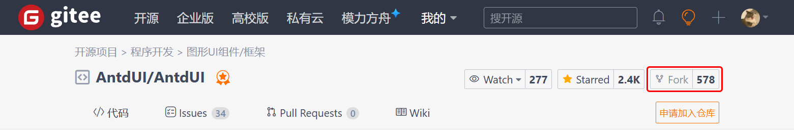
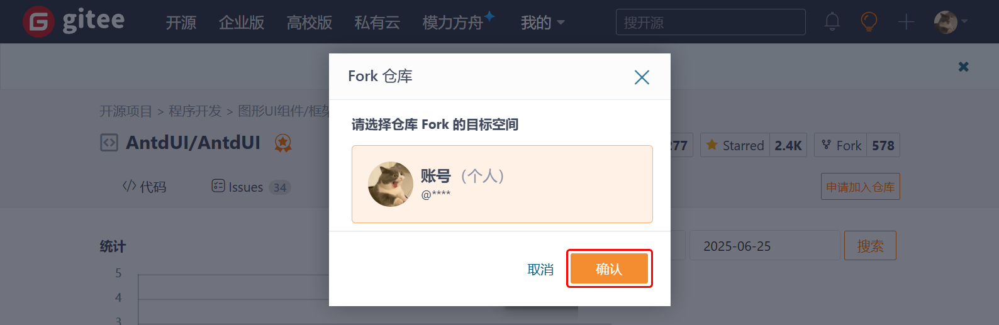
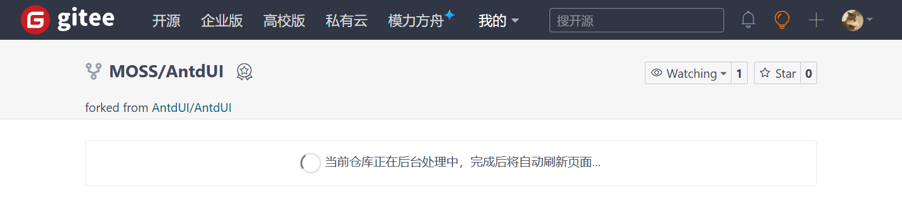
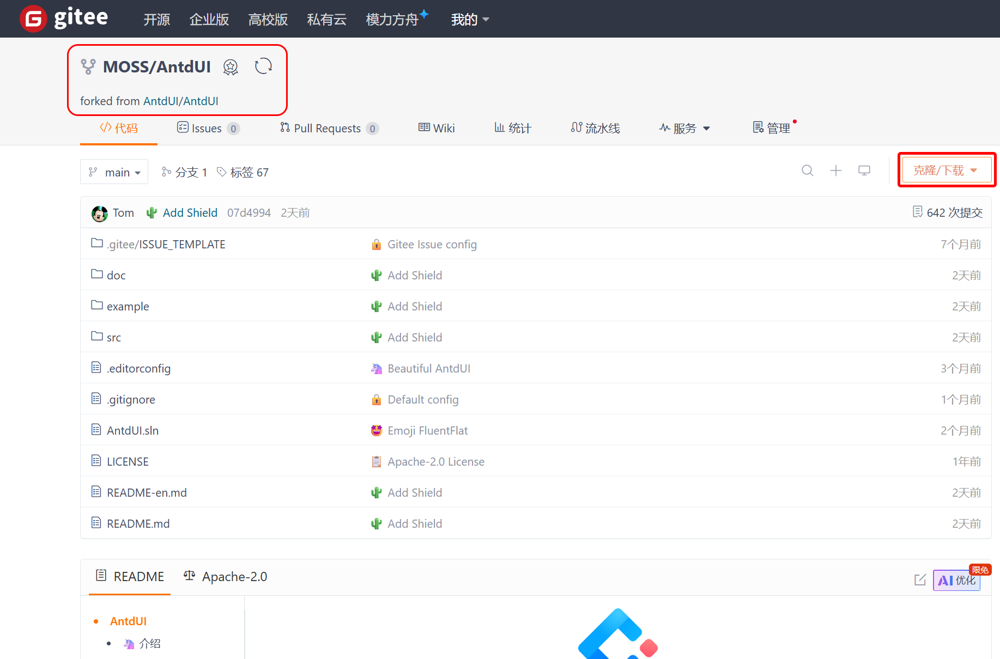
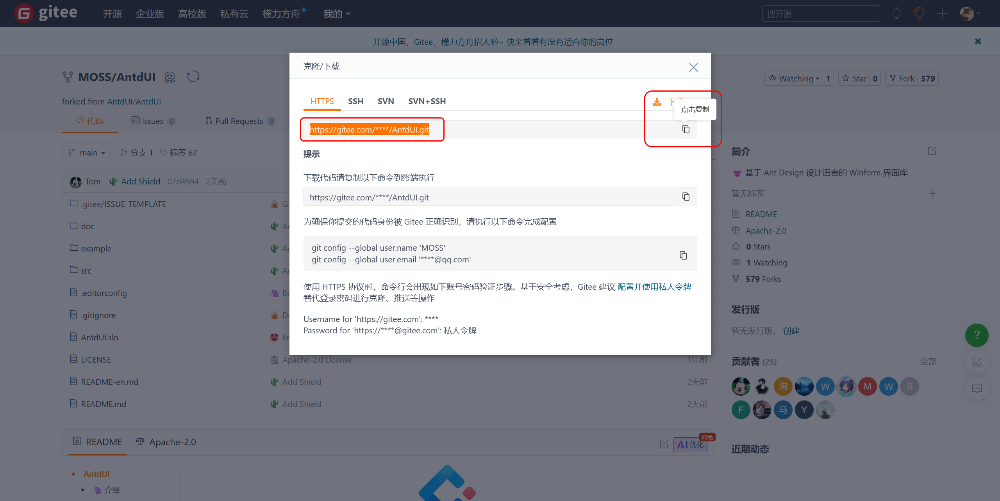
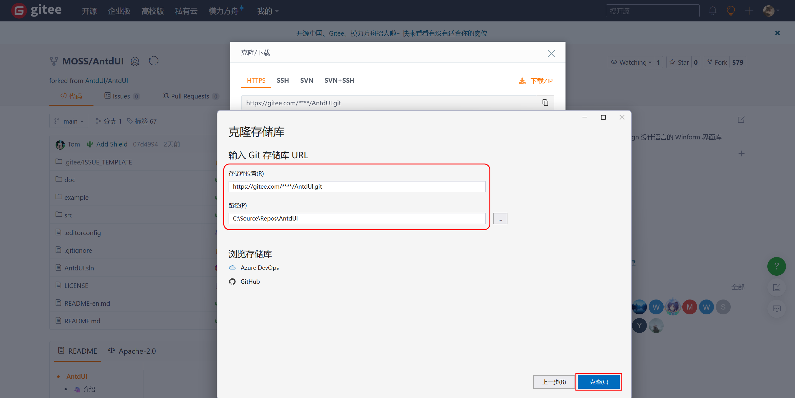
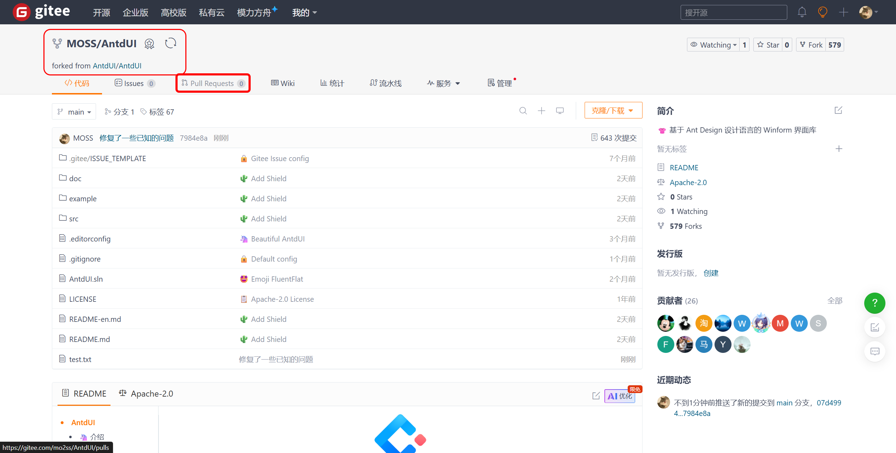
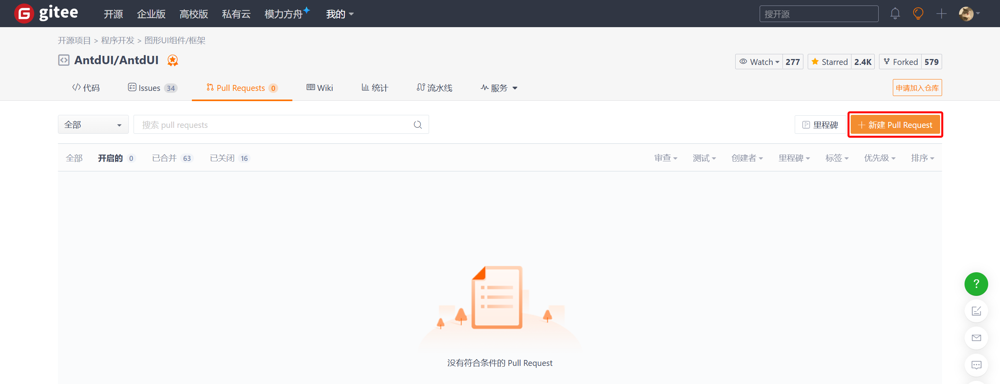
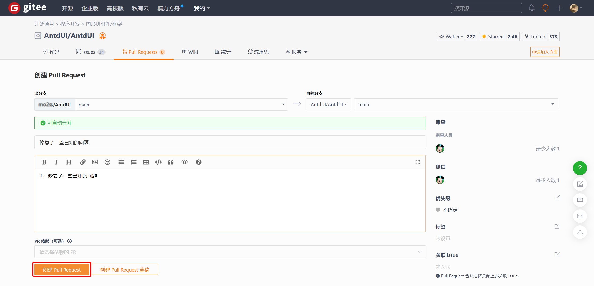

# 🦄 参与 AntdUI 贡献

本文档将介绍参与 AntdUI 贡献的标准和工作流程，帮助你顺利协作、保持代码一致性，并高效熟悉项目。

## 目录

1. [目录结构](#1-目录结构)
2. [代码规范](#2-代码规范)
   - 2.1 [总则](#21-总则)
   - 2.2 [自定义控件：IControl](#22-自定义控件icontrol)
   - 2.3 [窗口：BaseForm / Window](#23-窗口baseform--window)
   - 2.4 [分层窗口：ILayeredForm 体系](#24-分层窗口ilayeredform-体系)
   - 2.5 [全局事件：IEventListener / EventHub](#25-全局事件ieventlistener--eventhub)
   - 2.6 [动画：AnimationTask](#26-动画animationtask)
   - 2.7 [工具方法：Helper](#27-工具方法helper)
3. [贡献流程](#3-贡献流程)
4. [PR 合并后同步自己的 Fork 仓库](#4-pr-合并后同步自己的-fork-仓库)
5. [异常情况处理](#5-异常情况处理)
   - 5.1 [Fork 与官方仓库不一致](#51-fork-与官方仓库不一致)
   - 5.2 [提交错乱——删除 Fork 重新克隆](#52-提交错乱删除-fork-重新克隆)
   - 5.3 [提交错分支了](#53-提交错分支了)
   - 5.4 [PR 被要求修改](#54-pr-被要求修改)

---

## 1. 目录结构
请先了解项目的目录布局，确保你的贡献内容放在正确位置：

```
AntdUI/
├─ src/                      # 所有核心库源代码
│  ├─ AntdUI/                # 主UI库代码
│  │  ├─ Controls/           # 自定义UI控件
│  │  │  ├─ Chat/            # 聊天相关控件（因逻辑独立或代码量较大而单独存放）
│  │  │  └─ Core/            # 核心绘制类和实现类
│  │  ├─ Design/             # 设计器支持（如Visual Studio设计器集成）
│  │  ├─ Enum/               # 库中通用的枚举（如主题类型、控件状态）
│  │  ├─ Events/             # 事件定义
│  │  ├─ Forms/              # 自定义窗口/表单
│  │  │  └─ LayeredWindow/   # 弹窗/分层窗口（如下拉框、日期选择器、模态框、抽屉等）
│  │  ├─ Lib/                # 工具文件（Win32 API封装、SVG处理、辅助类）
│  │  │  └─ Helper/          # Helper 扩展方法（GDI、DPI、矩形、GIF、蒙版等）
│  │  ├─ Localization/       # 多语言支持（不同地区的资源文件）
│  │  └─ Style/              # 主题定义（如明暗主题、调色板）
│  └─ AntdUI.EmojiFluentFlat/ # Emoji Fluent Flat 资源库
├─ example/                  # 用于展示控件用法的示例项目
│  └─ Demo/                  # 主示例项目（包含所有控件的测试窗体）
└─ doc/                      # 文档（贡献指南、API参考等）
```

- **新增控件**：请添加到 `src/AntdUI/Controls/`（独立或大型控件可像 `Chat/` 一样使用子文件夹）。
- **工具代码**：辅助函数、Win32封装或SVG工具请放在 `src/AntdUI/Lib/`。
- **示例代码**：请更新 `example/Demo/` 以包含新功能的测试用例（有助于验证功能并帮助其他贡献者）。


## 2. 代码规范

> 本章给的是可以直接照抄的 API、调用位置和返回值含义。凡是写「必须」的地方，都是库内既有控件的统一做法，不这样做就会和整个库的行为不一致。

### 2.1 总则

1. **只做 UI**：AntdUI 是基于 WinForms 的纯 UI 库，只负责外观、布局、交互与主题适配。**禁止**在库内实现 HTTP 请求、文件传输、数据库访问、业务计算、账号体系等 UI 之外的逻辑；需要这些能力时，只提供可被外部实现的 API 对接点。
2. **不引入庞大依赖**：浏览器内核（CefSharp / WebView2）、ORM、日志/序列化框架、音视频编解码等一律不接受。.NET 生态已有更专业方案的领域，不要在本库再做一层美化封装。
3. **多框架兼容**：库同时面向多个 .NET 目标框架（见 [AntdUI.csproj](src/AntdUI/AntdUI.csproj) 的 `TargetFrameworks`），不要使用部分框架才有的 API，需要时用 `#if` 分支。
4. **零新增依赖**：新增 `PackageReference` 必须先与维护者确认。
5. **保持风格一致**：命名、注释、`[Description]`/`[Category]`/`[DefaultValue]` 特性、属性变更时的 `Invalidate()` + `OnPropertyChanged()`，都与现有控件保持一致。


### 2.2 自定义控件：IControl

源码：[IControl.cs](src/AntdUI/Controls/IControl.cs)

**继承与构造函数**

```csharp
public class MyControl : IControl
{
    public MyControl() : base(ControlType.Select) { }
}
```

`ControlType` 决定焦点与点击行为：

| 值 | 适合的控件 | 行为差异 |
| --- | --- | --- |
| `ControlType.Default` | 纯展示控件（Label、Tag、图片） | 不进 Tab 顺序、不抢焦点 |
| `ControlType.Select` | 输入/选择类（Input、Select、Tree） | 可获得焦点，支持键盘输入 |
| `ControlType.Button` | 点击类（Button、分段项） | 在 `Select` 基础上关闭系统双击派发，避免双击触发两次 `Click` |

**绘制入口**

```csharp
protected override void OnDraw(DrawEventArgs e)
{
    base.OnDraw(e);
    e.Canvas.DrawText("Hello 👍", Font, ForeColor, e.Rect, FormatFlags.Left | FormatFlags.VerticalCenter);
}
```

- 背景画在 `OnDrawBg`，内容画在 `OnDraw`；两者都由基类 `OnPaint` 依次调用。
- `e.Canvas` 是本控件的绘制对象，`e.Rect` 是可用区域。
- **不要**在 `OnPaint` 里画业务内容：它的输出会被 `OnDraw` 覆盖。`OnPaint` 只在封装系统控件、需要临时拿 Canvas 时使用（`e.Graphics.High(Dpi)`）。
- 需要把控件渲染成图片（导出、缓存）时用 `DrawBitmap()`。

**色彩模式与取色**

```csharp
// 每个控件都能独立指定：TAMode.Auto（跟随 Config.Mode）/ Light / Dark
public TAMode ColorScheme { get; set; } = TAMode.Auto;

// 取色：色卡代号 + 色彩模式 + 控件类名 + 控件实例 Name
Color fore = Colour.Text.Get(ColorScheme, nameof(MyControl), Name);
Color back = Colour.Primary.Get(ColorScheme, nameof(MyControl), Name);
```

匹配顺序为「色卡代号 + 实例 Name」→「色卡代号 + 类名」→「色卡代号」→ 系统色（[Style.cs](src/AntdUI/Style/Style.cs#L116)）。带颜色代号的场景用 `Colour.Text.GetSymbol(ColorScheme, symbol, nameof(MyControl), Name)`。

> 不要写死颜色值。如果你的控件确实需要一个固定色（品牌色、语义色），把它做成公开属性（例如 `public Color BadgeColor { get; set; } = ...`），让使用者可以修改，默认值再取自色卡。

**DPI**

```csharp
int height = (int)(32 * Dpi);   // Dpi：1f = 100%，1.5f = 150%
```

- 所有像素尺寸都乘 `Dpi`，不要用硬编码像素。
- 需要跨控件响应 DPI 变化时，用 `IEventListener` 的 `DPI` 事件（见 2.5），而不是自己监听显示器。

**RenderRegion（圆角 / 内边距）**

```csharp
public override GraphicsPath RenderRegion => ClientRectangle.RoundPath(Radius * Dpi);
```

基类默认返回整个 `ClientRectangle`。控件有圆角或有 Padding 时重写它，返回真实可见区域；同时用 `ReadRectangle => ClientRectangle.PaddingRect(Padding)` 表示内容区。这样 Spin 加载遮罩、覆盖元素、裁剪都会贴合控件形状。不重写圆角控件，遮罩会显示成矩形。

**鼠标 + 滚动条协同（重点）**

列表类控件的鼠标事件必须**先交给滚动条，再处理业务**，用 `&&` 串联。任一为 `false` 表示「滚动条已经处理掉了，业务别再响应」：

```csharp
protected override void OnMouseDown(MouseEventArgs e)
{
    base.OnMouseDown(e);
    if (ScrollBar.MouseDownY(e.X, e.Y) && ScrollBar.MouseDownX(e.X, e.Y))
    {
        if (items == null || items.Count == 0) return;
        OnTouchDown(e.X, e.Y);   // 记录触屏起点，见下文
        // 业务：命中条目、记录按下项
    }
}

protected override void OnMouseMove(MouseEventArgs e)
{
    base.OnMouseMove(e);
    if (ScrollBar.MouseMoveY(e.X, e.Y) && ScrollBar.MouseMoveX(e.X, e.Y))
    {
        if (items == null || items.Count == 0) return;
        if (OnTouchMove(e.X, e.Y))
        {
            // 业务：悬停高亮、拖拽
        }
    }
}

protected override void OnMouseUp(MouseEventArgs e)
{
    base.OnMouseUp(e);
    if (ScrollBar.MouseUpY() && ScrollBar.MouseUpX() && OnTouchUp())
    {
        // 业务：触发 Click、结束拖拽
    }
}
```

返回值含义：

| 调用 | 返回 `true` | 返回 `false` |
| --- | --- | --- |
| `ScrollBar.MouseDownX/Y(x, y)` | 坐标不在滚动条上 → 业务继续 | 按在滚动条上，已开始拖动滑块 → 业务跳过 |
| `ScrollBar.MouseMoveX/Y(x, y)` | 不在滚动条上、也没在拖动滑块 → 业务继续 | 在滚动条上或正在拖动滑块（`ValueX/ValueY` 已内部更新） → 业务跳过 |
| `ScrollBar.MouseUpX/Y()` | 本次没有拖动滑块 → 业务继续 | 刚拖动过滑块，抬起动作已被消费 → 业务跳过，避免拖动结束误触发 Click |
| `OnTouchDown(x, y)` | 无返回值，记录触屏起点 | — |
| `OnTouchMove(x, y)` | 本次移动未被判定为滚动 → 业务继续 | 已经作为滚动消费（含惯性滚动） → 业务跳过 |
| `OnTouchUp()` | 本次手势不是滚动，可以当作点击处理 → 业务继续 | 这是一次滚动手势 → 业务跳过，不要触发点击 |
| `OnTouchScrollX/Y(x, y, value)` | 已消费该位移 | 不支持该方向或已到边界，事件交还鼠标处理 |

参考完整实现：[Tree.cs](src/AntdUI/Controls/Tree.cs#L998)。

**触屏适配**

基类已经封装好「按下 → 移动 → 抬起」的判定、阈值、惯性滚动，你只需要实现两个滚动回调和三个业务钩子：

```csharp
// 1) 位移滚动：把位移交给滚动条，返回 true 表示已消费
protected override bool OnTouchScrollY(int x, int y, int value) => ScrollBar.MouseWheelYCore(value);
protected override bool OnTouchScrollX(int x, int y, int value) => ScrollBar.MouseWheelXCore(value);

// 2) 业务钩子：按下面的顺序在鼠标事件里调用（见上一节示例）
//    OnTouchDown → OnTouchMove（返回 true 才执行业务）→ OnTouchUp（返回 true 才执行业务）
```

- 手柄按下用 `OnTouchDown`、移动用 `OnTouchMove`、抬起用 `OnTouchUp`，与 `ScrollBar.MouseXxxX/Y` 一起用 `&&` 串起来。
- 移动距离超过阈值（`Config.TouchThreshold * Dpi`）才会被判定为滚动；滚动期间 `OnTouchMove` 返回 `false`，业务不会被误触发。
- 需要临时关闭触屏滚动时设置 `Config.TouchEnabled = false`。
- 参考：[Tree.cs](src/AntdUI/Controls/Tree.cs#L1360)。

**鼠标悬停**

```csharp
protected override bool CanMouseMove { get; set; } = true;   // 默认 false，需要悬停反馈才打开

protected override bool OnMouseHover(int x, int y)
{
    var item = HitTest(x, y);       // 自己实现
    if (item == hovering) return false;
    hovering = item;
    if (item == null) { CloseTip(); return false; }
    OpenTip(item.Tip);              // 显示提示
    return true;
}
```

- `OnMouseHover` 返回 `true`：当前坐标命中了需要悬停反馈的元素（继续显示 Tooltip / 高亮）。
- 返回 `false`：空白区域或状态没变化，基类会关闭悬停会话。
- 基类会把高频 `MouseMove` 合并，只在鼠标停顿 `Config.MouseHoverDelay` 毫秒后回调一次，所以不要在 `OnMouseMove` 里自己判断悬停并 `Invalidate()`，否则会反复绘制、闪烁。

**文本渲染**

| 场景 | 测量 | 绘制 |
| --- | --- | --- |
| 确定不含 Emoji | `MeasureString` | `String` |
| 可能含 Emoji | `MeasureText` | `DrawText` |

```csharp
var flags = FormatFlags.Left | FormatFlags.VerticalCenter;
int h = e.Canvas.MeasureText("Hello 👍", Font, e.Rect.Width, flags);
e.Canvas.DrawText("Hello 👍", Font, fore, e.Rect, flags);
```

两者只接受 `FormatFlags`（`StringFormat` 重载已标记 `[Obsolete]`）。`String` / `DrawText` 已经做过高质量文本渲染和垂直居中修正；`MeasureText` / `DrawText` 额外适配 Emoji 字形，含 Emoji 的文本用 `MeasureString` 会算小、画歪。

**图片 / SVG / Canvas 获取**

```csharp
e.Canvas.Image(bmp, rect, 0.5F);                        // 带透明度
e.Canvas.Image(rectF, bmp, TFit.Contain);               // 按布局适配
e.Canvas.Svg(svg, rect, colour);                        // SVG 染色 + DPI 适配

e.Graphics.High(Dpi);      // 封装系统控件时，在 OnPaint 里取 Canvas
e.Graphics.HighLay();      // 离屏位图绘制（Bitmap + Graphics.FromImage）
```

**资源释放**

`Bitmap` / `Brush` / `Pen` / `GraphicsPath` / `Font` 用完立即 `using` 或 `Dispose`；缓存型资源（阴影位图、渐变画刷）统一在 `Dispose(bool)` 里释放。局部泄漏在长时间运行的桌面程序里会表现为 GDI 对象持续增长，最后绘制失败。

**滚动条**

- 禁止使用系统滚动条，一律用 `AntdUI.ScrollBar`，并且把 `ShowScrollBar`、`ScrollBarSize` 之类的属性开放给使用者。
- 滚动条尺寸依赖控件区域，在 `OnSizeChanged` / `OnResize` 里更新 `ScrollBar.Size`，在数据或行高变化时更新 `ScrollBar.SetValue`。


### 2.3 窗口：BaseForm / Window

源码：[BaseForm.cs](src/AntdUI/Forms/BaseForm.cs)

```csharp
public class MyForm : BaseForm { }
```

- 构造时已开启双缓冲与自绘，不需要再 `SetStyle`。
- 主题：`Dark`、`Mode`（`TAMode`）、`DisableTheme`、`Theme()` / `ThemeClear()`；需要在深浅色切换时改自己的配色，重写 `OnThemeChanged` 或用 `IEventListener` 的 `THEME` 事件。
- DPI：`AutoHandDpi` 默认 `true`，收到 DPI 变化会自动重排；自定义布局放在 `OnCreated()` 里首次初始化。
- 拖动/缩放现成可用：
  - `DraggableMouseDown()`：在标题栏区域的 `MouseDown` 里调用即可拖动窗口
  - `ResizableMouseMove()` / `ResizableMouseMove(Point)`：命中边缘时自动切换光标
  - `ResizableMouseDown()`：命中边缘时进入系统缩放
  - `HitTest(Point)`：返回命中区域；`EnableHitTest = false` 可整体关闭
- 无边框窗口用 `Window`（[Window.cs](src/AntdUI/Forms/Window.cs#L15)），它通过 `IMessageFilter` 处理全局鼠标消息，`Dispose` 时会自动移除过滤器。

> 窗口 `Close` 不会释放你创建的 GDI 资源。复用窗口（Show/Hide）时，画刷、字体、缓存位图必须在 `Dispose(bool)` 里释放。


### 2.4 分层窗口：ILayeredForm 体系

源码：[ILayeredForm.cs](src/AntdUI/Forms/LayeredWindow/ILayeredForm.cs)

下拉、菜单、浮层都用这套基类。选型：

| 需求 | 选择 |
| --- | --- |
| 只有淡入淡出 | `ILayeredFormOpacity` |
| 下拉/弹出（位移 + 缩放 + 淡入淡出） | `ILayeredFormOpacityDown` |
| 下拉 + 阴影 | `ILayeredShadowForm`（继承自 `ILayeredFormOpacityDown`） |
| 阴影 + 仅淡入淡出 | `ILayeredShadowFormOpacity`（继承自 `ILayeredFormOpacity`） |
| 多级子菜单 | 额外实现 `SubLayeredForm` |

**必须做的事**

1. 在构造函数里算出窗口位置和大小：`TargetRect` 是屏幕坐标下的目标区域，`TargetRectXY` 是本地绘制区域；用 `SetRect` / `SetSize` / `SetLocation` 系列方法写入。
2. 实现 `PrintBit()` 返回整窗位图：

```csharp
public override Bitmap? PrintBit()
{
    var bmp = new Bitmap(Width, Height);
    using (var g = Graphics.FromImage(bmp))
    using (var canvas = g.HighLay(Dpi))
    {
        // 用 TargetRectXY 作为绘制区域
    }
    return bmp;
}
```

3. 需要显示/刷新时调用 `Print()`；**只是移动窗口或用缓存帧做动画**时调用 `PrintCache()`，它复用已上传的 DIB，不重新绘制，CPU 占用明显更低。
4. 关闭统一走 `IClose()`（内部已处理线程安全与委托），需要额外清理就重写 `IClosing()`。

**关闭方式 `CloseMode`**：`None`（不自动关闭）、`Click`（点击其他区域关闭）、`Leave`（离开窗口/控件关闭）、`NoControl`（不把父控件算作内部区域）。配合 `AreaJudge` 判断「鼠标是否还在有效区域」。

**无焦点**：`UFocus` 默认 `true`，窗口不抢焦点；需要窗口被激活时重写为 `false`。

**多级子窗口与安全三角区**

主窗口实现 `SubLayeredForm` 并返回子窗口：

```csharp
public class MyMenu : ILayeredShadowForm, SubLayeredForm
{
    MyMenu? subForm;

    public ILayeredForm? SubForm() => subForm;

    // 开启安全三角区：鼠标斜向移动到子菜单时不会误判"离开"而关闭
    public override bool EnableSafetyTriangleZone => true;
    public override Rectangle? OnSafetyTriangleZone(int x, int y) => subForm?.TargetRect;
}
```

- 子窗口用 `Show(this)` 打开，即可无限层级。
- 为什么需要安全三角区：鼠标从父菜单斜向移向子菜单时会短时间离开两个矩形窗口，`CloseMode.Leave` 会误关子菜单，导致点不到。基类会把当前点和子窗口区域连成三角形，落在三角形内就视为仍在窗口内。
- 参考实现：[LayeredFormContextMenuStrip.cs](src/AntdUI/Forms/LayeredWindow/LayeredFormContextMenuStrip.cs#L836)。

> 阴影类会把 `shadow2` 加进窗口尺寸和坐标，鼠标回调传入的 `x/y` 已经减掉 `shadow`，业务按内容区坐标绘制即可。


### 2.5 全局事件：IEventListener / EventHub

源码：[EventHub.cs](src/AntdUI/Lib/EventHub.cs)

```csharp
public class MyControl : IControl, IEventListener
{
    protected override void OnHandleCreated(EventArgs e)
    {
        base.OnHandleCreated(e);
        this.AddListener();          // 句柄创建后注册，一次即可
    }

    public void HandleEvent(EventType id, object? tag)
    {
        if (id == EventType.LANG) ChangeLanguage();      // 语言变了，刷新文本
        if (id == EventType.DPI) Invalidate();           // DPI 变了，重绘
    }
}
```

不需要手动反注册：监听以弱引用保存，控件 `Disposed` 时自动清理。`Dispatch` 由库内部触发，业务侧一般不用调。

| `EventType` | `tag` 类型 | 什么时候触发 |
| --- | --- | --- |
| `DPI` | `float`，1f = 100%，1.2f = 120% | 系统 DPI / 缩放变化，或 `Config.SetDpi` |
| `THEME` | `TMode` 或 `null` | `null` 表示由 `Style.LoadCustom` / `Style.Clear` 触发；非空为系统深浅色切换 |
| `LANG` | `CultureInfo` | 切换语言 |
| `THEME_PRIMARY` | 无 | 主色调变化 |
| `WINDOW_STATE` | 无 | 窗口最大化 / 最小化 / 还原 |
| `WINDOW_ACTIVATE` | `object[]`：`[0]` 窗口，`[1]` 是否激活 | 窗口激活状态变化 |
| `DIV` | 自定义 | 扩展用途 |


### 2.6 动画：AnimationTask

源码：[AnimationTask.cs](src/AntdUI/Lib/AnimationTask.cs)

```csharp
AnimationTask? task;

void StartScroll()
{
    task?.Dispose();                    // 先打断上一个，避免叠加
    task = new AnimationTask(new AnimationLinearConfig(this, v =>
    {
        ScrollBar.ValueY = v;
        return true;                    // 返回 false 提前结束
    }, 16, target, step).SetEnd(() => task = null).SetPriority());
}
```

| 配置类 | 构造参数 | 用途 |
| --- | --- | --- |
| `AnimationLinearConfig` | `(Control control, Func<int, bool> call, int interval, int max, int add)` | 整数线性递增（滚动、位移） |
| `AnimationLinearFConfig` | `(Control control, Func<float, bool> call, int interval, float max, float add)` | 浮点线性（透明度、缩放） |
| `AnimationLoopConfig` | `(Control control, Func<bool> call, int interval)` | 循环动画，回调返回 `false` 结束 |
| `AnimationFixedConfig` | `(Action<float> call, int interval, int totalFrames, bool sw, AnimationType value = Ball)` | 固定帧数插值 |
| `AnimationFixed2Config` | `(Action<int, float> call, int interval, int totalFrames, object? value, bool sw, AnimationType type = Ball)` | 固定帧数 + 保留旧值，可从中断处继续 |

- 打断：`task.Dispose()` 取消内部 `CancellationTokenSource`，五种配置都支持。
- 通用链式配置：`SetEnd(...)`（结束回调）、`SetSleep(...)`（每帧休眠）、`SetPriority()`（低优先级，不阻塞 UI）。
- 控件销毁时必须 `Dispose`，否则任务会继续持有控件并执行。


### 2.7 工具方法：Helper

源码：[Helper.cs](src/AntdUI/Lib/Helper/Helper.cs)、[Helper.GDI.cs](src/AntdUI/Lib/Helper/Helper.GDI.cs)、[Helper.RECT.cs](src/AntdUI/Lib/Helper/Helper.RECT.cs)、[Helper.DPI.cs](src/AntdUI/Lib/Helper/Helper.DPI.cs)

| 场景 | 用法 |
| --- | --- |
| 复制 / 粘贴文本 | `this.ClipboardGetText()` / `this.ClipboardSetText(text)`，内部自动 `Invoke` 到 UI 线程，可以直接在后台线程调用 |
| 列表搜索（含拼音、多关键字） | `Helper.SearchContains(search, text, py, out bool select)` 返回权重，0 表示不匹配；再对结果用 `SearchWeightSort()` / `SearchWeightSortArray()` 排序 |
| 只画可见行 | `if (e.Rect.IsItemVisible(ScrollBar.ValueY, itemRect)) { ... }`，展开项用 `IsItemVisibleExpand(...)` |
| H5 渐变色 | `"#1890ff,#52c41a"` 或 `"0:#1890ff,1:#52c41a"` 这类字符串交给 `code.BrushEx(rect, defColor)` 生成画刷；单色或空值自动回退到默认色 |
| 圆角路径 | `ClientRectangle.RoundPath(radius)`，支持四角独立半径、`TShape.Round`、`TAlignRound` |
| 阴影 | `e.Canvas.PaintShadow(config, rect, rectRead, radius, round)`；离屏阴影用 `path.PaintShadow(w, h, color, range)` |
| 徽标 | 实现了 `BadgeConfig` 的控件在 `OnPaint` 里已被自动绘制；自定义绘制用 `this.PaintBadge(e.Canvas)` |
| 空状态 | `e.Canvas.PaintEmpty(rect, Font, fore, "暂无数据", image)`，图片与文案统一排版 |
| 毛玻璃 | `Helper.Blur(bitmap, range)` 对目标位图做高斯模糊 |
| GIF | `Helper.IsGIF(img)` / `GIFDelays` / `GIFPlay(img, isRun, action)` 逐帧播放，图片控件不要直接赋值 `Image` |
| 遮罩层 | `this.FormMask(form)` 返回遮罩窗体，`owner.ShowDialogMask(form, out var mask)` 模态显示 |
| DPI 工具 | `Helper.GetScreenDpi(this)`、`Helper.GetDpi(96, 96)`、`Helper.DpiAuto(dpi, control)` 自动重排子控件 |


## 3. 贡献流程

> 以下演示如何通过 [**合并请求（Pull Request，简称PR）**](https://gitee.com/AntdUI/AntdUI/compare/main...main) 贡献代码


### 3.1 首先在 [AntdUI](https://gitee.com/AntdUI/AntdUI) 官方仓库 Fork 到自己账号

> 点击右上角 **Fork** 按钮



### 3.2 选择 Fork 目标空间

> 默认个人，也就是自己，点击 **确认** 继续



> 等待 Fork 完成，完成后会自动跳转
> 

### 3.3 在自己空间地址克隆项目

> 点击 **克隆/下载**，⚠ 注意是自己的**空间地址**



点击第一个 `.git` 地址复制



### 3.4 提交贡献代码到自己仓库

> 打开 [Visual Studio](https://visualstudio.microsoft.com) 克隆刚刚复制的地址，选择目录，点击 **克隆** 继续



克隆成功后，提交需要贡献的代码

### 3.5 发起 [PR](https://gitee.com/AntdUI/AntdUI/compare/main...main)

> 点击 **Pull requests** 选项卡，或者[点击**Pull Request**跳转提交PR页面](https://gitee.com/AntdUI/AntdUI/compare/main...main)



点击 **新建 Pull Request**



### 3.6 大功告成

提交内容调整核实后，点击 **创建 Pull Request**



> 收到后，我会尽快审核，🧙 生活愉快

---

## 4. PR 合并后同步自己的 Fork 仓库

> 维护者合并你的 PR 后，官方仓库已向前推进，但**你的 Fork 不会自动更新**。下次贡献前，请务必将自己的 Fork 与上游 `main` 分支保持一致。

打开你 Fork 后的仓库，点击 **同步** / **Sync fork** → **更新分支** / **Update branch**。若按钮显示 **已是最新** / **No changes**，说明 Fork 已同步。


随后在本地拉取最新代码，使工作区与上游一致：

```bash
# 确保处于 main 分支
git checkout main

# 从你的 Fork（origin）拉取最新代码
git pull origin main
```

> 小技巧：如果配置了 `upstream` 远程指向官方仓库，可直接从上游同步：
> ```bash
> git remote add upstream https://gitee.com/AntdUI/AntdUI.git
> git fetch upstream
> git merge upstream/main
> git push origin main
> ```

---

## 5. 异常情况处理

本节介绍贡献流程中常见的异常场景与处理办法。

### 5.1 Fork 与官方仓库不一致

**症状**：提交新 PR 时 Gitee 提示“此分支已过时”/“存在冲突，必须解决”。

**处理**：先按 [第 4 节：同步 Fork 仓库](#4-pr-合并后同步自己的-fork-仓库) 同步。如果分支上已经存在冲突：

```bash
git fetch upstream
git merge upstream/main
# 在编辑器中解决冲突后：
git add .
git commit
git push origin your-branch
```

### 5.2 提交错乱——删除 Fork 重新克隆

如果本地提交历史严重错乱、rebase 失败或冲突无法解决，最干净的做法是**删除 Fork 重新开始**：

1. **手动备份本地修改**。将你仍需保留的修改文件复制到仓库外的目录（例如 `D:\AntdUI_backup\`）。重新 Fork 会丢失所有提交和分支。
2. **删除 Fork**：Gitee 进入你的 Fork 仓库 → **管理** → 滚动到底部 → **删除仓库**，按提示输入完整仓库名确认。
3. **重新 Fork 官方仓库**：按 [3.1](#31-首先在-antdui-官方仓库-fork-到自己账号) 重新操作。
4. **重新克隆**：按 [3.3](#33-在自己空间地址克隆项目) 重新克隆新 Fork 到本地。
5. **手动恢复你保留的改动**：从备份目录将代码覆盖回新仓库，提交并发起新的 PR。

> ⚠ 警告：此操作具有破坏性。**删除 Fork 前**务必确认备份完整。任何未提交到远程且未备份的本地改动将永久丢失。

### 5.3 提交错分支了

如果不小心直接提交到 `main` 而非功能分支，可将提交迁移到新分支：

```bash
# 创建并切换到新分支，保留刚才的提交
git checkout -b my-feature-branch
# 将 main 重置回上游
git checkout main
git reset --hard upstream/main
git checkout my-feature-branch
```

### 5.4 PR 被要求修改

维护者要求修改后：

```bash
# 切换到 PR 所用分支
git checkout your-pr-branch

# 在编辑器中按要求修改，然后：
git add .
git commit -m "根据评审意见修改"
git push origin your-pr-branch
```

PR 会自动更新——无需另开新 PR。

---

感谢您为AntdUI的改进提供帮助——您的贡献让这个项目变得更好！🚀