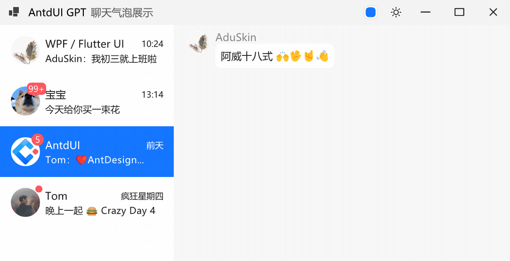

<h1>AntdUI</h1>

繁體中文・[简体中文](README.zh.md)・[English](README.md)・[文件](doc/wiki/zh-TW/Home.md)・[更新日誌](doc/wiki/zh/UpdateLog.md)・[範例](https://gitee.com/mubaiyanghua/antdui-demo)・[鳴謝](doc/wiki/zh/Thanks.md)

### 🦄 介紹

以 Ant Design 設計語言為基礎的 WinForm UI 介面庫，致力於將現代美觀的前端設計風格帶入桌面應用程式。採用純 GDI 繪圖，不需任何圖片資源，全面支援 AOT，最低相容 `.NET Framework 4.0`

### ✨ 特性

- 🌈 高品質抗鋸齒文字渲染
- 🎨 純 GDI 向量繪圖，可隨時中斷的流暢動畫效果
- 😍 Emoji 打破黑白界線，增添趣味
- 💎 WinForm 上最出色的陰影效果
- 📦 無邊框視窗，保有原生視窗特性
- 👚 主題設定，支援深色／淺色模式
- 📐 互動安全區
- 🌍 全球化支援
- 🦜 SVG 向量圖
- 👓 DPI 適應
- 🦺 AOT 發行

### 🖥 環境

- .NET 10.0
- .NET 8.0
- .NET Framework4.8
- .NET Framework4.0 及以上

### 🌴 元件

⬇️| 通用 `2` | 動畫 | 停用 |
:---:|:--|:--:|:--:|
➡️| [**Button** 按鈕](doc/wiki/zh/Control/Button.md) | ✅ | ✅ |
➡️| [**FloatButton** 浮動按鈕](doc/wiki/zh/Control/FloatButton.md) | ✅ | ✅ |
||||
⬇️| 版面編排 `5` | 動畫 | 停用 |
➡️| [**Divider** 分隔線](doc/wiki/zh/Control/Divider.md) | ❎ | ❎ |
➡️| [**StackPanel** 堆疊排列](doc/wiki/zh/Control/StackPanel.md) | ❎ | ❎ |
➡️| [**FlowPanel** 流動排列](doc/wiki/zh/Control/FlowPanel.md) | ❎ | ❎ |
➡️| [**GridPanel** 格狀排列](doc/wiki/zh/Control/GridPanel.md) | ❎ | ❎ |
➡️| [**Splitter** 分隔面板](doc/wiki/zh/Control/Splitter.md) | ❎ | ❎ |
||||
⬇️| 導覽 `7` | 動畫 | 停用 |
➡️| [**Breadcrumb** 階層導覽](doc/wiki/zh/Control/Breadcrumb.md) | ✅ | ❎ |
➡️| [**Dropdown** 下拉選單](doc/wiki/zh/Control/Dropdown.md) | ✅ | ✅ |
➡️| [**Menu** 導覽選單](doc/wiki/zh/Control/Menu.md) | ✅ | ✅ |
➡️| [**PageHeader** 頁首](doc/wiki/zh/Control/PageHeader.md) | ✅ | ❎ |
➡️| [**TabHeader** 多標籤頁首](doc/wiki/zh/Control/TabHeader.md) | ✅ | ✅ |
➡️| [**Pagination** 分頁](doc/wiki/zh/Control/Pagination.md) | ✅ | ✅ |
➡️| [**Steps** 步驟列](doc/wiki/zh/Control/Steps.md) | ❎ | ❎ |
||||
⬇️| 資料輸入 `16` | 動畫 | 停用 |
➡️| [**Checkbox** 核取方塊](doc/wiki/zh/Control/Checkbox.md) | ✅ | ✅ |
➡️| [**ColorPicker** 色彩選擇器](doc/wiki/zh/Control/ColorPicker.md) | ✅ | ✅ |
➡️| [**DatePicker** 日期選擇框](doc/wiki/zh/Control/DatePicker.md) | ✅ | ✅ |
➡️| [**DatePickerRange** 日期範圍選擇框](doc/wiki/zh/Control/DatePickerRange.md) | ✅ | ✅ |
➡️| [**Input** 輸入框](doc/wiki/zh/Control/Input.md) | ✅ | ✅ |
➡️| [**InputNumber** 數字輸入框](doc/wiki/zh/Control/InputNumber.md) | ✅ | ✅ |
➡️| [**Radio** 選項按鈕](doc/wiki/zh/Control/Radio.md) | ✅ | ✅ |
➡️| [**Rate** 評分](doc/wiki/zh/Control/Rate.md) | ✅ | ❎ |
➡️| [**Select** 選擇器](doc/wiki/zh/Control/Select.md) | ✅ | ✅ |
➡️| [**SelectNumber** 數字選擇器](doc/wiki/zh/Control/SelectNumber.md) | ✅ | ✅ |
➡️| [**Slider** 滑動輸入列](doc/wiki/zh/Control/Slider.md) | ✅ | ❎ |
➡️| [**SliderRange** 滑動範圍輸入列](doc/wiki/zh/Control/SliderRange.md) | ✅ | ❎ |
➡️| [**Switch** 開關](doc/wiki/zh/Control/Switch.md) | ✅ | ✅ |
➡️| [**TimePicker** 時間選擇框](doc/wiki/zh/Control/TimePicker.md) | ✅ | ✅ |
➡️| [**Transfer** 穿梭框](doc/wiki/zh/Control/Transfer.md) | ✅ | ❎ |
➡️| [**UploadDragger** 拖曳上傳](doc/wiki/zh/Control/UploadDragger.md) | ✅ | ❎ |
||||
⬇️| 資料顯示 `26` | 動畫 | 停用 |
➡️| [**Avatar** 大頭貼](doc/wiki/zh/Control/Avatar.md) | ❎ | ❎ |
➡️| [**Badge** 徽章數](doc/wiki/zh/Control/Badge.md) | ✅ | ❎ |
➡️| [**Calendar** 日曆](doc/wiki/zh/Control/Calendar.md) | ✅ | ❎ |
➡️| [**Panel** 面板](doc/wiki/zh/Control/Panel.md) | ✅ | ❎ |
➡️| [**Carousel** 輪播](doc/wiki/zh/Control/Carousel.md) | ✅ | ❎ |
➡️| [**Collapse** 摺疊面板](doc/wiki/zh/Control/Collapse.md) | ✅ | ❎ |
➡️| [**Descriptions** 描述清單](doc/wiki/zh/Control/Descriptions.md) | ✅ | ❎ |
➡️| [**Statistic** 統計數值](doc/wiki/zh/Control/Statistic.md) | ✅ | ❎ |
➡️| [**Preview** 圖片預覽](doc/wiki/zh/Control/Preview.md) | ✅ | ❎ |
➡️| [**ImagePreview** 圖片預覽](doc/wiki/zh/Control/ImagePreview.md) | ✅ | ❎ |
➡️| [**Popover** 氣泡卡片](doc/wiki/zh/Control/Popover.md) | ✅ | ❎ |
➡️| [**Segmented** 分段控制器](doc/wiki/zh/Control/Segmented.md) | ✅ | ✅ |
➡️| [**Table** 表格](doc/wiki/zh/Control/Table.md) | ✅ | ✅ |
➡️| [**EditableTable** 可編輯表格](doc/wiki/zh/Control/EditableTable.md) | ✅ | ❎ |
➡️| [**Tabs** 標籤頁](doc/wiki/zh/Control/Tabs.md) | ✅ | ✅ |
➡️| [**Tag** 標籤](doc/wiki/zh/Control/Tag.md) | ✅ | ❎ |
➡️| [**Timeline** 時間軸](doc/wiki/zh/Control/Timeline.md) | ❎ | ❎ |
➡️| [**Tooltip** 文字提示](doc/wiki/zh/Control/Tooltip.md) | ✅ | ❎ |
➡️| [**Tree** 樹狀元件](doc/wiki/zh/Control/Tree.md) | ✅ | ✅ |
➡️| [**Tour** 導覽式引導](doc/wiki/zh/Control/Tour.md) | ✅ | ❎ |
➡️| [**Label** 文字](doc/wiki/zh/Control/Label.md) | ✅ | ❎ |
➡️| [**LabelTime** 時間文字](doc/wiki/zh/Control/LabelTime.md) | ✅ | ❎ |
➡️| [**LabelLed** LED 文字](doc/wiki/zh/Control/LabelLed.md) | ✅ | ❎ |
➡️| [**HyperlinkLabel** 超連結文字](doc/wiki/zh/Control/HyperlinkLabel.md) | ✅ | ❎ |
➡️| [**HyperlinkCheckbox** 超連結核取方塊](doc/wiki/zh/Control/HyperlinkCheckbox.md) | ✅ | ❎ |
➡️| **Chart** 圖表 | ✅ | ❎ |
||||
⬇️| 回饋 `8` | 動畫 | 停用 |
➡️| [**Alert** 警告提示](doc/wiki/zh/Control/Alert.md) | ✅ | ❎ |
➡️| [**Drawer** 抽屜](doc/wiki/zh/Control/Drawer.md) | ✅ | ❎ |
➡️| [**Message** 全域提示](doc/wiki/zh/Control/Message.md) | ✅ | ❎ |
➡️| [**Modal** 對話方塊](doc/wiki/zh/Control/Modal.md) | ✅ | ❎ |
➡️| [**Notification** 通知提醒框](doc/wiki/zh/Control/Notification.md) | ✅ | ❎ |
➡️| [**Progress** 進度列](doc/wiki/zh/Control/Progress.md) | ✅ | ❎ |
➡️| [**Spin** 載入中](doc/wiki/zh/Control/Spin.md) | ✅ | ❎ |
➡️| [**Watermark** 浮水印](doc/wiki/zh/Control/Watermark.md) | ✅ | ❎ |
||||
⬇️| 聊天 `2` | 動畫 | 停用 |
➡️| **MsgList** 好友訊息清單 | ✅ | ❎ |
➡️| **ChatList** 氣泡聊天清單 | ✅ | ❎ |
||||
⬇️| 其他 `9` | 動畫 | 停用 |
➡️| [**Battery** 電量](doc/wiki/zh/Control/Battery.md) | ✅ | ❎ |
➡️| [**Signal** 訊號強度](doc/wiki/zh/Control/Signal.md) | ✅ | ❎ |
➡️| [**Shield** 徽章](doc/wiki/zh/Control/Shield.md) | ❎ | ❎ |
➡️| [**ContextMenuStrip** 右鍵選單](doc/wiki/zh/Control/ContextMenuStrip.md) | ✅ | ❎ |
➡️| [**Image3D** 圖片 3D](doc/wiki/zh/Control/Image3D.md) | ✅ | ❎ |
➡️| **Docking** 停靠面板 | ✅ | ❎ |
➡️| **Ribbon** 工具列 | ✅ | ❎ |
➡️| **OutlookBar** 導覽列 | ✅ | ❎ |
➡️| [**Markdown** MD 渲染元件](doc/wiki/zh/Control/Markdown.md) | ✅ | ❎ |

### 🐿️ 贊助

### 🎨 螢幕截圖

#### ChatUI

> 純 GDI，不是 TextBox 等拖曳元件

## 📢 特別聲明

AntdUI 專案已加入 [dotNET China](https://gitee.com/dotnetchina) 組織。 

🦦 招募夥伴一起維護專案