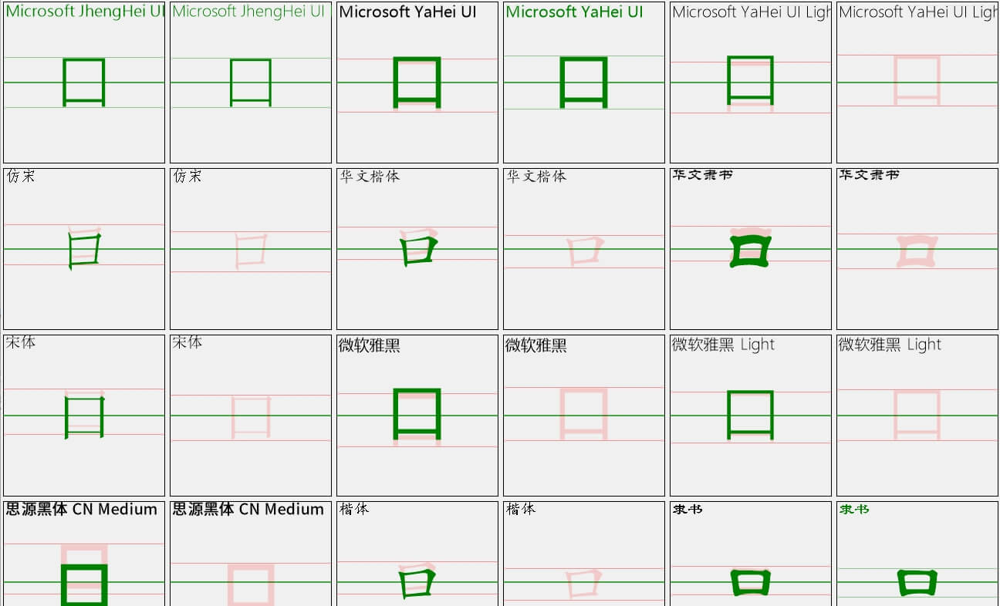

[首頁](Home.md)・[更新日誌](../zh/UpdateLog.md)・[設定](Config.md)・[主題](Theme.md)

> `AntdUI.Config` 用於全域設定，建議在 `Program.cs` 的 `Main` 方法中、建立視窗之前完成設定。

### 色彩模式

> 預設淺色模式

#### 設定／取得色彩模式

``` csharp
AntdUI.Config.Mode = AntdUI.TMode.Light;
```

> 🔴 .NET 10 及以上：設定 `Mode` 會同步呼叫 `Application.SetColorMode`，讓系統元件與 AntdUI 一起切換明暗。若要跟隨系統，請在**存取 `AntdUI.Config` 之前**呼叫 `Application.SetColorMode(SystemColorMode.System);`，因為 `Config` 的靜態建構函式會在第一次存取時讀取系統色彩模式作為初始值。詳見 [主題](Theme.md#net-10-跟隨系統色彩模式)。

#### 是否淺色模式

``` csharp
bool islight = AntdUI.Config.IsLight;
AntdUI.Config.IsLight = true;// 設為淺色模式
```

#### 是否深色模式

``` csharp
bool isdark = AntdUI.Config.IsDark;
AntdUI.Config.IsDark = true;// 設為深色模式
```

#### 設定全域切換主題 🔴

> 設定後，繼承 [BaseForm](../zh/Form/BaseForm.md) 的視窗會自動切換主題

``` csharp
AntdUI.Config.Theme()
.Light("#fff", "#000") // 淺色模式背景 白色(#fff) | 前景 黑色(#000)
.Dark("#000", "#fff") // 深色模式背景 黑色(#000) | 前景 白色(#fff)
.Header("#f3f3f3", "#111111"); // PageHeader 頁首背景 淺色背景色 淺灰色(#f3f3f3) | 深色背景色 深灰色(#111111)
```

> 更多主題功能（品牌色、色彩演算法、跟隨系統等）請見 [主題](Theme.md)。

#### 主題設定物件

> `Theme()` 是便捷入口（為空時自動建立）；`ThemeConfig` 是可讀寫的底層屬性，可直接指派自訂的設定物件

``` csharp
AntdUI.IThemeConfig? config = AntdUI.Config.ThemeConfig; // 取得（可能為 null）
AntdUI.Config.ThemeConfig = config;                      // 直接設定
```

#### 清除主題設定

``` csharp
AntdUI.Config.ThemeClear();
```

### 動畫

> 預設開啟動畫

``` csharp
AntdUI.Config.Animation = false;
```

#### 依元件開關動畫

> 可針對指定的元件類型（元件名稱）單獨停用動畫，`params` 支援傳入多個名稱

``` csharp
AntdUI.Config.DisableAnimation("Button", "Input"); // 停用 Button、Input 的動畫
AntdUI.Config.EnableAnimation("Button"); // 恢復 Button 的動畫（移除停用項目）
AntdUI.Config.ClearAnimationData(); // 清除所有停用設定，全部恢復
```

#### 查詢動畫是否啟用

``` csharp
bool enabled = AntdUI.Config.HasAnimation("Button"); // 依元件名稱查詢
bool enabled2 = AntdUI.Config.HasAnimation("Button", "btnOK"); // 同時依元件名稱 / 元件 Name 查詢
```

### 表格儲存格焦點樣式

> 全域預設 `TableCellFocusedStyle.None`（無焦點），可設為虛線框或實線填滿

``` csharp
AntdUI.Config.DefaultCellFocusedStyle = AntdUI.TableCellFocusedStyle.Solid;
```

### 觸控

#### 觸控啟用

> 預設啟用觸控

``` csharp
AntdUI.Config.TouchEnabled = true;
```

#### 觸控閾值

> 預設 `20`（像素），觸發觸控判定的位移閾值

``` csharp
AntdUI.Config.TouchThreshold = 20;
```

#### 觸控點擊啟用

``` csharp
AntdUI.Config.TouchClickEnabled = true;
```

#### 螢幕小鍵盤模式

> 預設 `Accessibility`（協助工具），可選 `Disabled`（停用）、`OpenOsk`（呼叫系統螢幕小鍵盤 osk）

``` csharp
AntdUI.Config.TouchKeyboard = AntdUI.TouchKeyboardMode.Accessibility;
```

#### 慣性捲動參數

> 用於調整清單、捲動區域的觸控慣性捲動手感

``` csharp
AntdUI.Config.TouchVelocityMin = .1F;   // 觸發慣性捲動的最小速度（像素/毫秒）
AntdUI.Config.TouchVelocityEnd = .01F;  // 慣性捲動停止的最小速度（像素/毫秒）
AntdUI.Config.TouchInterval = 20;       // 慣性捲動影格間隔（毫秒）
AntdUI.Config.TouchDecay = .94F;        // 慣性捲動每個影格的衰減係數
```

### 滑鼠停留時間

> 滑鼠停留觸發的延遲，預設 `100` 毫秒

``` csharp
AntdUI.Config.MouseHoverDelay = 100;
```

### 陰影

#### 陰影啟用

> 預設啟用陰影

``` csharp
AntdUI.Config.ShadowEnabled = false;
```

#### 陰影相容模式（支援多色）

``` csharp
AntdUI.Config.ShadowModeCompatible = true;
```

#### 陰影大小與透明度

``` csharp
AntdUI.Config.ShadowSize = 10;       // 陰影大小，預設 10 像素
AntdUI.Config.ShadowOpacity = 0.2F;  // 陰影透明度，預設 0.2
```

### 焦點邊框

> 預設啟用焦點邊框

``` csharp
AntdUI.Config.FocusBorderEnabled = false;
```

### 下拉邊距

> 下拉選單距離更遠（避免遮擋）

``` csharp
AntdUI.Config.DropDownMarginFurther = true;
```

### Emoji

#### Emoji 啟用

> 預設啟用 Emoji

``` csharp
AntdUI.Config.EmojiEnabled = true;
```

#### Emoji 字型

> 預設 `Segoe UI Emoji`

``` csharp
AntdUI.Config.EmojiFont = "Segoe UI Emoji";
```

### 使用攔截

> Release 預設啟用（DEBUG 下預設關閉），用於全域訊息攔截（Hook）

``` csharp
AntdUI.Config.UseHook = true;
```

### 捲軸

#### 捲軸隱藏樣式

> 預設一律顯示 `false`

``` csharp
AntdUI.Config.ScrollBarHide = false;
```

#### 捲軸最小大小

> `ScrollMinSizeY` 預設 `30`，`ScrollMinSizeX` 預設 `null`

``` csharp
AntdUI.Config.ScrollMinSizeY = 30;
AntdUI.Config.ScrollMinSizeX = 30;
```

### 在視窗內彈出 Message/Notification

> 預設在螢幕上彈出

``` csharp
AntdUI.Config.ShowInWindow = true;
```

<details>
<summary>個別設定</summary>

> 彈出時是否顯示在視窗裡而不是系統中（Message）
``` csharp
AntdUI.Config.ShowInWindowByMessage = true;
```

> 彈出時是否顯示在視窗裡而不是系統中（Notification）
``` csharp
AntdUI.Config.ShowInWindowByNotification = true;
```

</details>

### 通知訊息邊界位移量 XY（Message/Notification）

> 預設 0

``` csharp
AntdUI.Config.NoticeWindowOffsetXY = 0;
```

### 通知超出顯示數量後立即關閉舊的（Message/Notification）

> 預設超出後，等到有舊的關閉才顯示

``` csharp
AntdUI.Config.NoticeOverflowClose = false;
```

### 文字呈現品質

``` csharp
AntdUI.Config.TextRenderingHint = System.Drawing.Text.TextRenderingHint.ClearTypeGridFit;
```

### 文字高品質呈現

``` csharp
AntdUI.Config.TextRenderingHighQuality = true;
```

### 預設字型 🔴

> 此屬性已標記為過時（Obsolete），如需全域字型請使用專案層級的預設字型設定

``` csharp
AntdUI.Config.Font = new Font("微软雅黑", 10);
```

### 取得 DPI

> 1=100%、1.25=125%，以此類推

``` csharp
float dpi = AntdUI.Config.Dpi;
```

### DPI 模式

> 預設 `DpiMode.Default`，版面異常時可切換為 `DpiMode.Compatible` 相容模式。詳見 [DPI](DPI.md)

``` csharp
AntdUI.Config.DpiMode = AntdUI.DpiMode.Compatible;
```

### 自訂 DPI

> 傳入 `null` 可恢復自動取得

``` csharp
AntdUI.Config.SetDpi(1.5F);
AntdUI.Config.SetDpi(null); // 恢復自動
```

### 設定修正文字算繪

``` csharp
AntdUI.Config.SetCorrectionTextRendering("Microsoft YaHei UI", "宋体"); //需要修正的字型清單
```



### 空白圖

> 載入中 / 空狀態使用的預留圖，可設定圖片與寬高比，或用 SVG 分別指定淺色 / 深色

``` csharp
AntdUI.Config.EmptyImage = myImage;      // 自訂空白圖
AntdUI.Config.EmptyImageRatio = 2.98F;   // 寬高比，預設 2.98

AntdUI.Config.SetEmptyImageSvg(lightSvg, darkSvg); // 設定淺色 / 深色 SVG
AntdUI.Config.ClearEmptyImageSvg();                // 清除自訂 SVG
```

### 空文字預留位置

> 常數 `Config.NullText`，內部用於區分真正的空值（一般不需修改）

``` csharp
string nullText = AntdUI.Config.NullText;
```