# 📚 AntdUI 文件

> 以 [dotnet Winforms](https://github.com/dotnet/winforms) 開發的介面庫

繁體中文・[简体中文](../zh/Home.md)・[English](../en/Home.md)・[更新日誌](../zh/UpdateLog.md)

## 🎯 指南

- [**安裝** - 介面庫入門](Install.md)
- [**DPI** - 高解析度模糊／字型看起來不清晰](DPI.md)
- [**設定** - 全域設定](Config.md)
- [**主題** - 淺色深色模式 自訂主題](Theme.md)
- [**SVG** - 引用／來源](SVG.md)
- [**AOT** - 原生程式碼](AOT.md)

## 🧰 元件

### 通用 `2`

#### [Button 按鈕](../zh/Control/Button.md)

> 按鈕用於開始一個即時操作。
> 
> [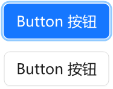](../zh/Control/Button.md)

#### [FloatButton 浮動按鈕](../zh/Control/FloatButton.md)

> 浮動按鈕。
> 
> 

### 版面編排 `5`

#### [Divider 分隔線](../zh/Control/Divider.md)

> 區隔內容的分隔線。
> 
> [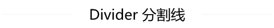](../zh/Control/Divider.md)

#### [StackPanel 堆疊排列](../zh/Control/StackPanel.md)

> 依水平或垂直方向排列子元素。
> 
> [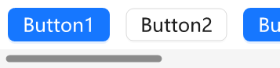](../zh/Control/StackPanel.md)

#### [FlowPanel 流動排列](../zh/Control/FlowPanel.md)

> 依列排列子元素，自動換行。
> 
> [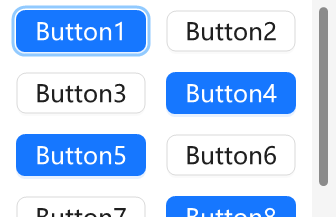](../zh/Control/FlowPanel.md)

#### [GridPanel 格狀排列](../zh/Control/GridPanel.md)

> 將內容劃分為列和欄的格線。
> 
> [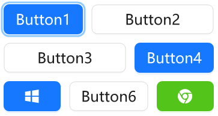](../zh/Control/GridPanel.md)

#### [Splitter 分隔面板](../zh/Control/Splitter.md)

> 自由切分指定區域。
> 
> [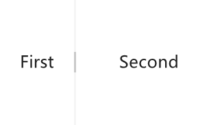](../zh/Control/Splitter.md)

### 導覽 `7`

#### [Breadcrumb 階層導覽](../zh/Control/Breadcrumb.md)

> 顯示目前頁面在系統階層結構中的位置，並能往上返回。
> 
> [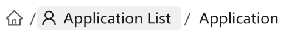](../zh/Control/Breadcrumb.md)

#### [Dropdown 下拉選單](../zh/Control/Dropdown.md)

> 向下彈出的清單。
> 
> [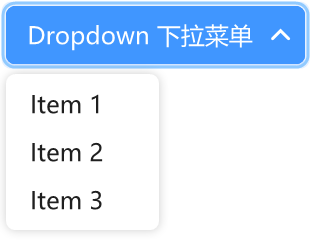](../zh/Control/Dropdown.md)

#### [Menu 導覽選單](../zh/Control/Menu.md)

> 為頁面和功能提供導覽的選單清單。
> 
> [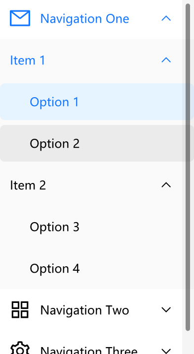](../zh/Control/Menu.md)

#### [PageHeader 頁首](../zh/Control/PageHeader.md)

> 頁面頂部與三大視窗控制鈕，具有內容概覽和引導頁面層級操作的作用。
> 
> 

#### [TabHeader 多標籤頁首](../zh/Control/TabHeader.md)

> 多標籤頁切換頁首。
> 
> [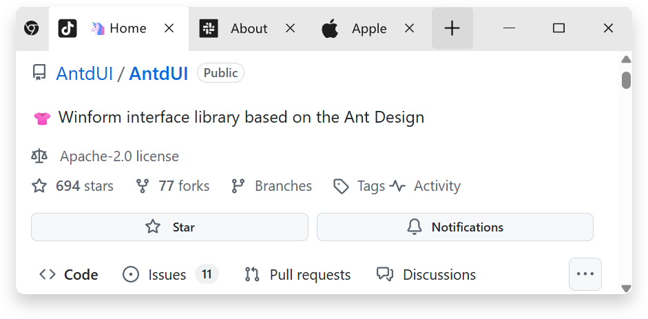](../zh/Control/TabHeader.md)

#### [Pagination 分頁](../zh/Control/Pagination.md)

> 以分頁的形式分隔長清單，每次只載入一個頁面。
> 
> 

#### [Steps 步驟列](../zh/Control/Steps.md)

> 引導使用者依照流程完成任務的導覽列。
> 
> [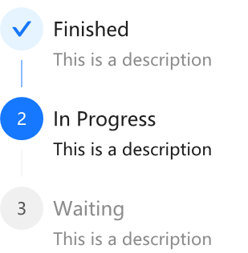](../zh/Control/Steps.md)

### 資料輸入 `16`

#### [Checkbox 核取方塊](../zh/Control/Checkbox.md)

> 核取方塊。
> 
> 

#### [ColorPicker 色彩選擇器](../zh/Control/ColorPicker.md)

> 提供色彩選取的元件。
> 
> [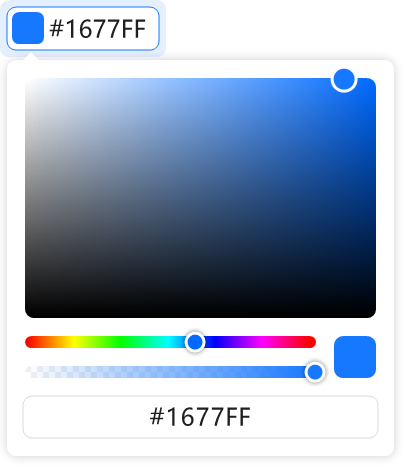](../zh/Control/ColorPicker.md)

#### [DatePicker 日期選擇框](../zh/Control/DatePicker.md)

> 輸入或選擇日期的元件。
> 
> [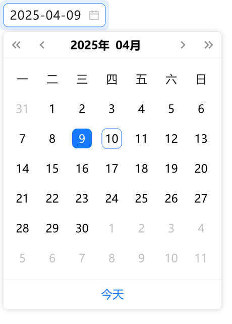](../zh/Control/DatePicker.md)

#### [DatePickerRange 日期範圍選擇框](../zh/Control/DatePickerRange.md)

> 輸入或選擇日期範圍的元件。
> 
> [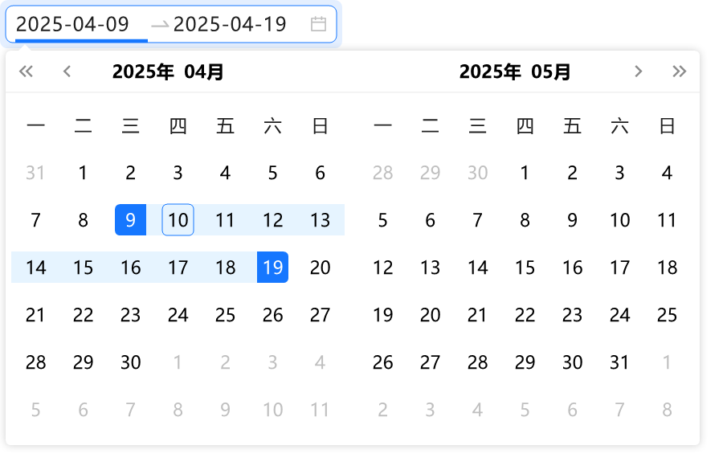](../zh/Control/DatePickerRange.md)

#### [Input 輸入框](../zh/Control/Input.md)

> 透過滑鼠或鍵盤輸入內容，是最基礎的表單欄位封裝
> 
> 

#### [InputNumber 數字輸入框](../zh/Control/InputNumber.md)

> 透過滑鼠或鍵盤，輸入範圍內的數值
> 
> [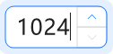](../zh/Control/InputNumber.md)

#### [Radio 選項按鈕](../zh/Control/Radio.md)

> 選項按鈕
> 
> 

#### [Rate 評分](../zh/Control/Rate.md)

> 評分元件
> 
> 

#### [Select 選擇器](../zh/Control/Select.md)

> 下拉選擇器
> 
> [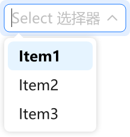](../zh/Control/Select.md)

#### [SelectNumber 數字選擇器](../zh/Control/SelectNumber.md)

> 數字下拉選擇器，支援自訂範圍、步進值和格式化。
> 
> [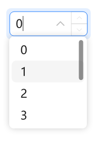](../zh/Control/SelectNumber.md)

#### [Slider 滑動輸入列](../zh/Control/Slider.md)

> 滑動型輸入器，顯示目前值和可選範圍
> 
> 

#### [SliderRange 滑動範圍輸入列](../zh/Control/SliderRange.md)

> 滑動型範圍輸入器
> 
> 

#### [Switch 開關](../zh/Control/Switch.md)

> 開關選擇器
> 
> 

#### [TimePicker 時間選擇框](../zh/Control/TimePicker.md)

> 輸入或選擇時間的元件
> 
> [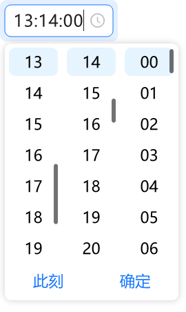](../zh/Control/TimePicker.md)

#### [Transfer 穿梭框](../zh/Control/Transfer.md)

> 雙欄穿梭選擇框，用於在兩個區域之間移動項目
> 
> [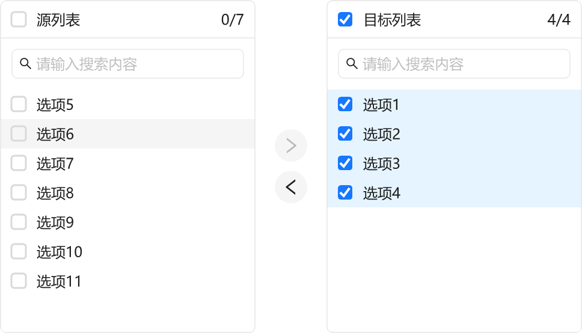](../zh/Control/Transfer.md)

#### [UploadDragger 拖曳上傳](../zh/Control/UploadDragger.md)

> 檔案選擇上傳和拖曳上傳元件
> 
> [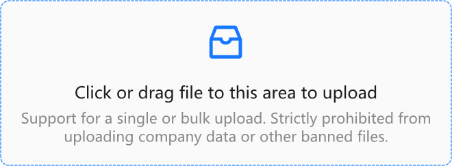](../zh/Control/UploadDragger.md)

### 資料顯示 `25`

#### [Avatar 大頭貼](../zh/Control/Avatar.md)

> 用來代表使用者或事物，支援圖片、圖示或字元顯示
> 
> 

#### [Badge 徽章數](../zh/Control/Badge.md)

> 圖示右上角的圓形徽章數字
> 
> [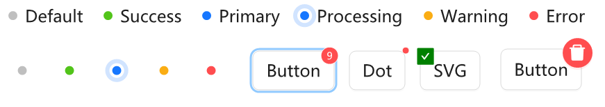](../zh/Control/Badge.md)

#### [Calendar 日曆](../zh/Control/Calendar.md)

> 以日曆形式顯示資料的容器
> 
> [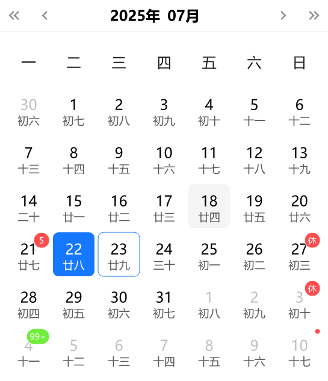](../zh/Control/Calendar.md)

#### [Panel 面板](../zh/Control/Panel.md)

> 內容區域
> 
> 

#### [Carousel 輪播](../zh/Control/Carousel.md)

> 旋轉木馬，一組輪播的區域
> 
> 

#### [Collapse 摺疊面板](../zh/Control/Collapse.md)

> 可以摺疊／展開的內容區域
> 
> [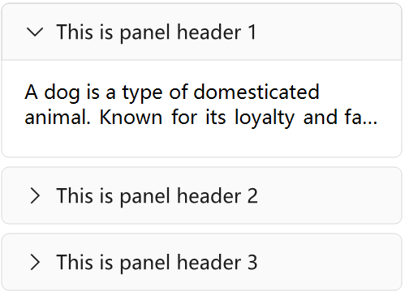](../zh/Control/Collapse.md)

#### [Descriptions 描述清單](../zh/Control/Descriptions.md)

> 顯示多個唯讀欄位的組合。
> 
> [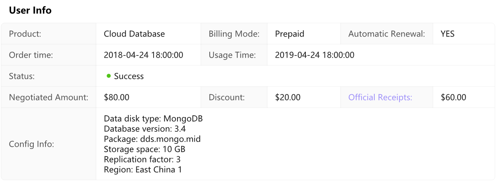](../zh/Control/Descriptions.md)

#### [Statistic 統計數值](../zh/Control/Statistic.md)

> 統計數值顯示，支援圓餅圖／折線圖。

#### [Preview 圖片預覽](../zh/Control/Preview.md)

> 圖片預覽框
> 
> 

#### [ImagePreview 圖片預覽](../zh/Control/ImagePreview.md)

> 圖片預覽元件

#### [Popover 氣泡卡片](../zh/Control/Popover.md)

> 彈出氣泡式的卡片浮層。
> 
> 

#### [Segmented 分段控制器](../zh/Control/Segmented.md)

> 分段控制器。
> 
> [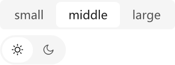](../zh/Control/Segmented.md)

#### [Table 表格](../zh/Control/Table.md)

> 顯示列與欄的資料。
> 
> [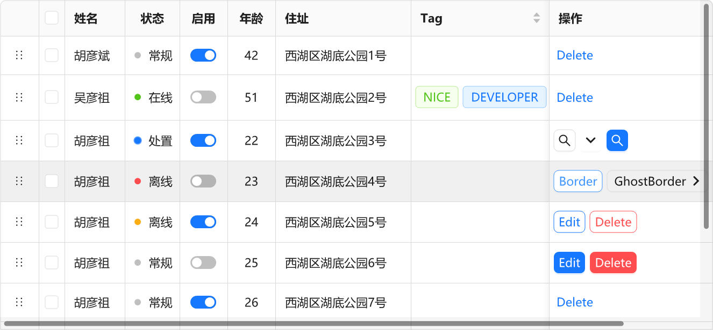](../zh/Control/Table.md)

#### [EditableTable 可編輯表格](../zh/Control/EditableTable.md)

> 列層級編輯表格，整列同時進入編輯狀態，支援儲存驗證與取消還原（[Table](../zh/Control/Table.md) 的變體，PR #182）。

#### [Tabs 標籤頁](../zh/Control/Tabs.md)

> 索引標籤切換元件。
> 
> [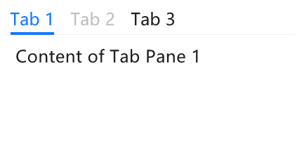](../zh/Control/Tabs.md)

#### [Tag 標籤](../zh/Control/Tag.md)

> 用於標記和分類的小標籤。
> 
> [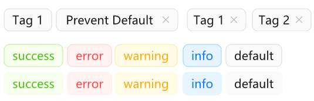](../zh/Control/Tag.md)

#### [Timeline 時間軸](../zh/Control/Timeline.md)

> 垂直顯示的時間流資訊。
> 
> [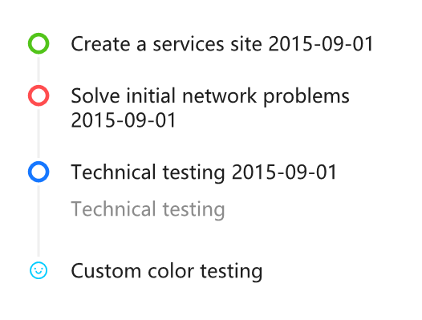](../zh/Control/Timeline.md)

#### [Tooltip 文字提示](../zh/Control/Tooltip.md)

> 簡單的文字提示氣泡框。
> 
> 

#### [Tree 樹狀元件](../zh/Control/Tree.md)

> 多層次的結構清單。
> 
> [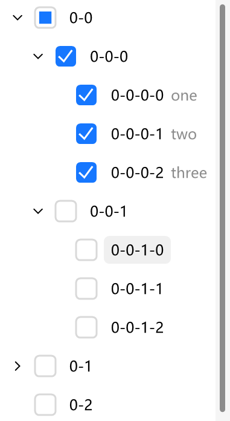](../zh/Control/Tree.md)

#### [Tour 導覽式引導](../zh/Control/Tour.md)

> 用於分步驟引導使用者瞭解產品功能的氣泡元件。
> 
> [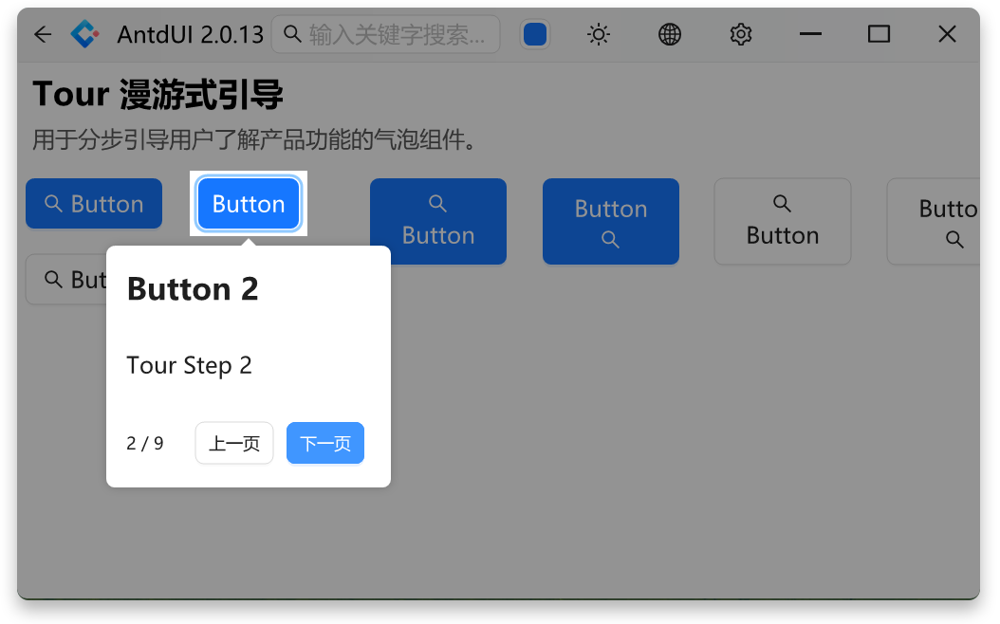](../zh/Control/Tour.md)

#### [Label 文字](../zh/Control/Label.md)

> 顯示一段文字。

#### [LabelTime 時間文字](../zh/Control/LabelTime.md)

> 顯示時間文字。
> 
> [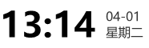](../zh/Control/LabelTime.md)

#### [LabelLed LED 文字元件](../zh/Control/LabelLed.md)

> 顯示一段 LED 樣式的文字。
> 
> [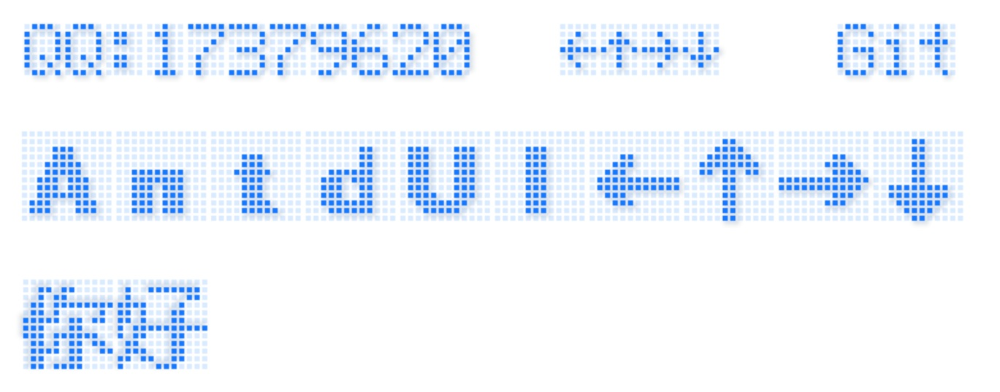](../zh/Control/LabelLed.md)

#### [HyperlinkLabel 超連結文字](../zh/Control/HyperlinkLabel.md)

> 顯示帶有超連結的文字，支援自訂樣式和事件處理。
> 
> 

#### [HyperlinkCheckbox 超連結核取方塊](../zh/Control/HyperlinkCheckbox.md)

> 顯示帶有超連結的核取方塊，支援自訂樣式和事件處理。
> 
> 

### 回饋 `8`

#### [Alert 警告提示](../zh/Control/Alert.md)

> 警告提示，呈現需要關注的資訊。
> 
> [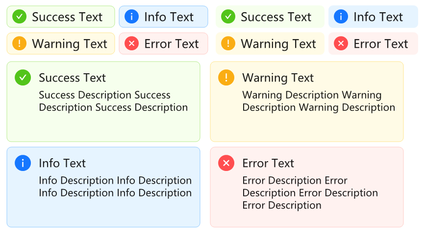](../zh/Control/Alert.md)

#### [Drawer 抽屜](../zh/Control/Drawer.md)

> 從螢幕邊緣滑出的浮層面板。
> 
> 

#### [Message 全域提示](../zh/Control/Message.md)

> 全域顯示操作回饋訊息。
> 
> 

#### [Modal 對話方塊](../zh/Control/Modal.md)

> 強制回應對話方塊。
> 
> 

#### [Notification 通知提醒框](../zh/Control/Notification.md)

> 全域顯示通知提醒訊息。
> 
> 

#### [Progress 進度列](../zh/Control/Progress.md)

> 顯示操作的目前進度。
> 
> [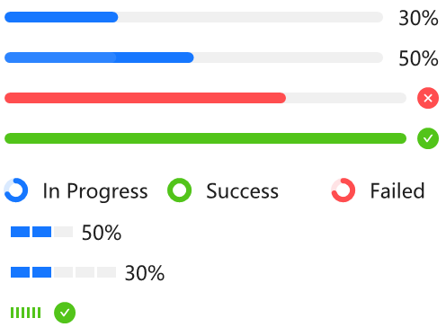](../zh/Control/Progress.md)

#### [Spin 載入中](../zh/Control/Spin.md)

> 用於頁面和區塊的載入中狀態。
> 
> [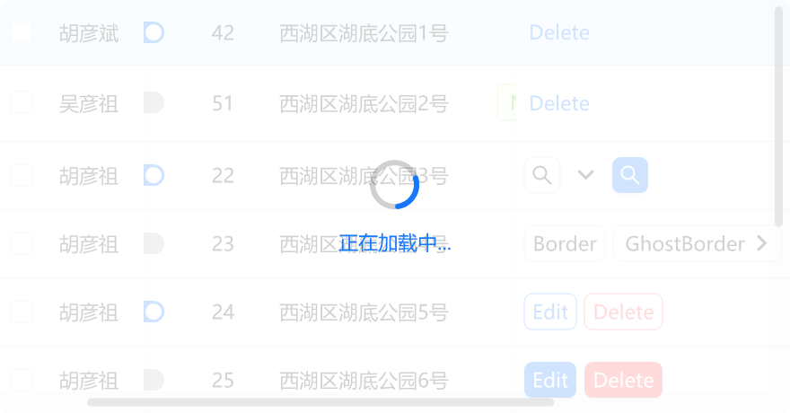](../zh/Control/Spin.md)

#### [Watermark 浮水印](../zh/Control/Watermark.md)

> 為頁面的某個區域加上浮水印。
> 
> [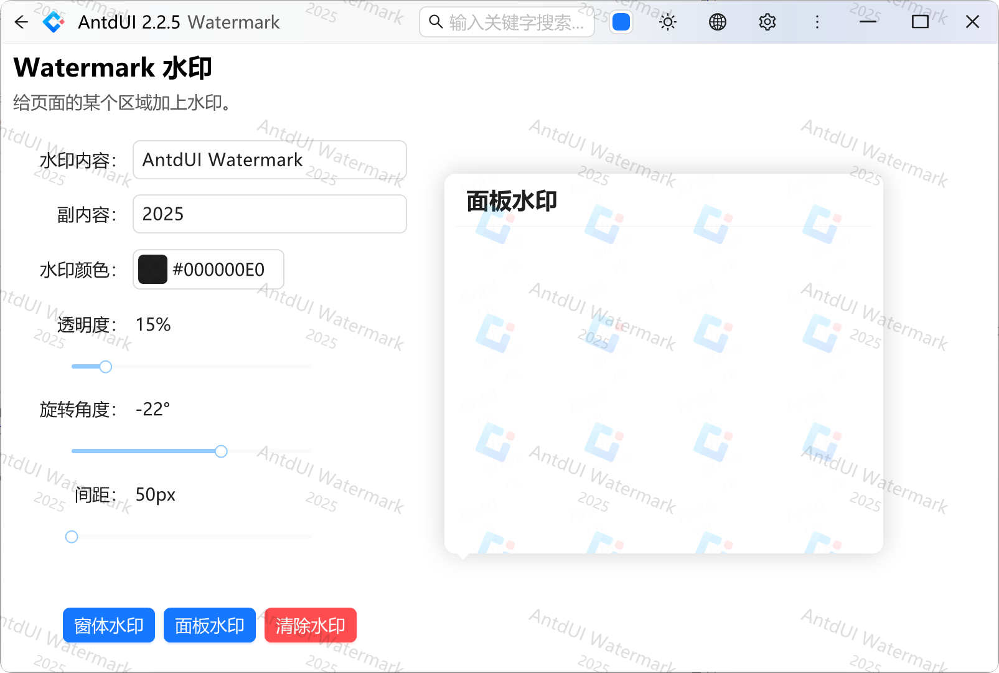](../zh/Control/Watermark.md)

### 其他 `6`

#### ~~[WindowBar 視窗列](../zh/Control/WindowBar.md)~~

> ⚠ 已移除 請改用 [PageHeader 頁首](../zh/Control/PageHeader.md)

#### [Battery 電量](../zh/Control/Battery.md)

> 顯示裝置電量
> 
> 

#### [Signal 訊號強度](../zh/Control/Signal.md)

> 顯示裝置訊號
> 
> 

#### [Shield 徽章](../zh/Control/Shield.md)

> 顯示徽章圖示
> 
> [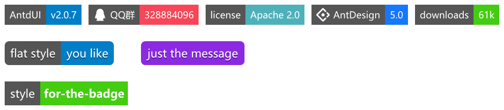](../zh/Control/Shield.md)

#### [ContextMenuStrip 右鍵選單](../zh/Control/ContextMenuStrip.md)

> 顯示右鍵選單
> 
> [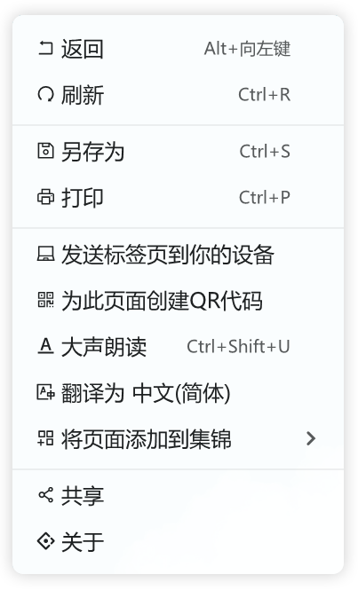](../zh/Control/ContextMenuStrip.md)

#### [Image3D 圖片 3D](../zh/Control/Image3D.md)

> 顯示 3D 效果圖片
> 
> [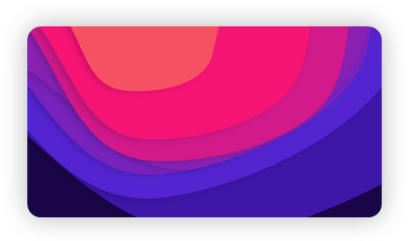](../zh/Control/Image3D.md)

#### [Markdown](../zh/Control/Markdown.md)

> MD 算繪元件
> 
> [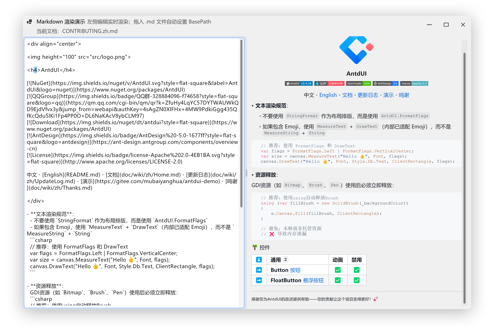](../zh/Control/Markdown.md)

## 🪟 視窗

### 視窗 `3`

#### [Window](../zh/Form/Window.md)

> 具原生特性的視窗 `隱藏標題列`

#### [BorderlessForm](../zh/Form/BorderlessForm.md)

> 無邊框視窗 `GDI 陰影`

#### [BaseForm](../zh/Form/BaseForm.md)

> DPI 基礎視窗
