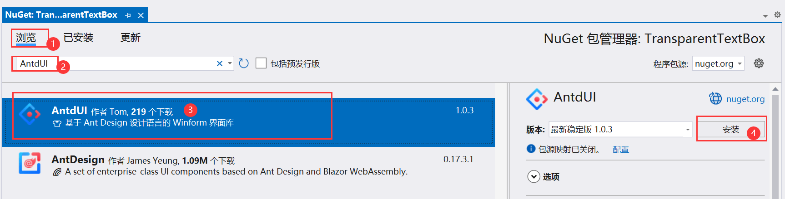
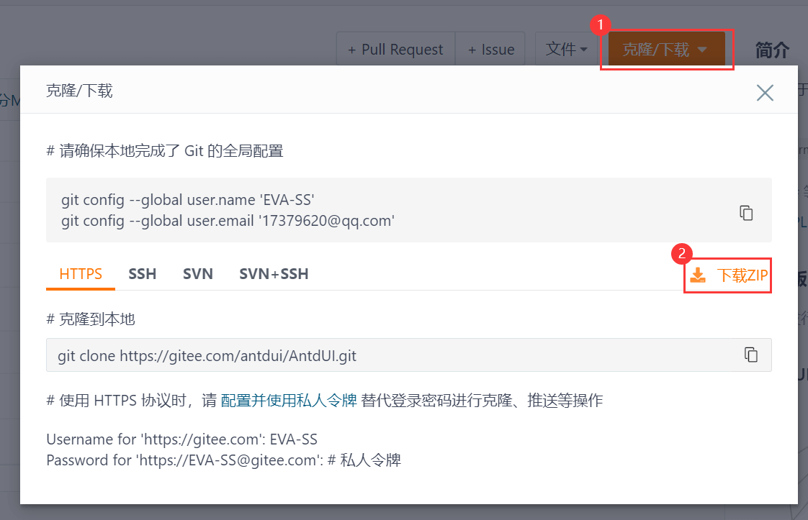

[首頁](Home.md)・[更新日誌](../zh/UpdateLog.md)・[設定](../zh/Config.md)・[主題](../zh/Theme.md)

## 安裝

### NuGet 安裝

> 👏 建議使用 NuGet 快速安裝

#### 透過 Visual Studio 視覺化安裝

#### 透過 PM 指令安裝
PM> `Install-Package AntdUI`

---

### 下載原始碼

> 開啟 AntdUI 的 Gitee（碼雲）網址：[https://gitee.com/AntdUI/AntdUI](https://gitee.com/AntdUI/AntdUI)

解壓縮後按兩下開啟 `AntdUI.sln` 方案，將 `examples/Demo` 專案設為起始專案，按 `F5` 啟動

#### 原始碼下載後無法編譯？

> 編譯器需要 **Visual Studio 2022** 以上版本

[Visual Studio 安裝舊版本 (.NET Framework 4.0 和 4.5)](../zh/InstallOldVersionFramework.md)

#### 看不到工具箱？

需將 `AntdUI.csproj` 內的 `TargetFrameworks` 只保留自己專案使用的框架版本，然後重新建置

> 操作完仍無法顯示，請重新啟動 VS 讓它重新載入，**多重新建置幾次以確保 dll 是最新的**